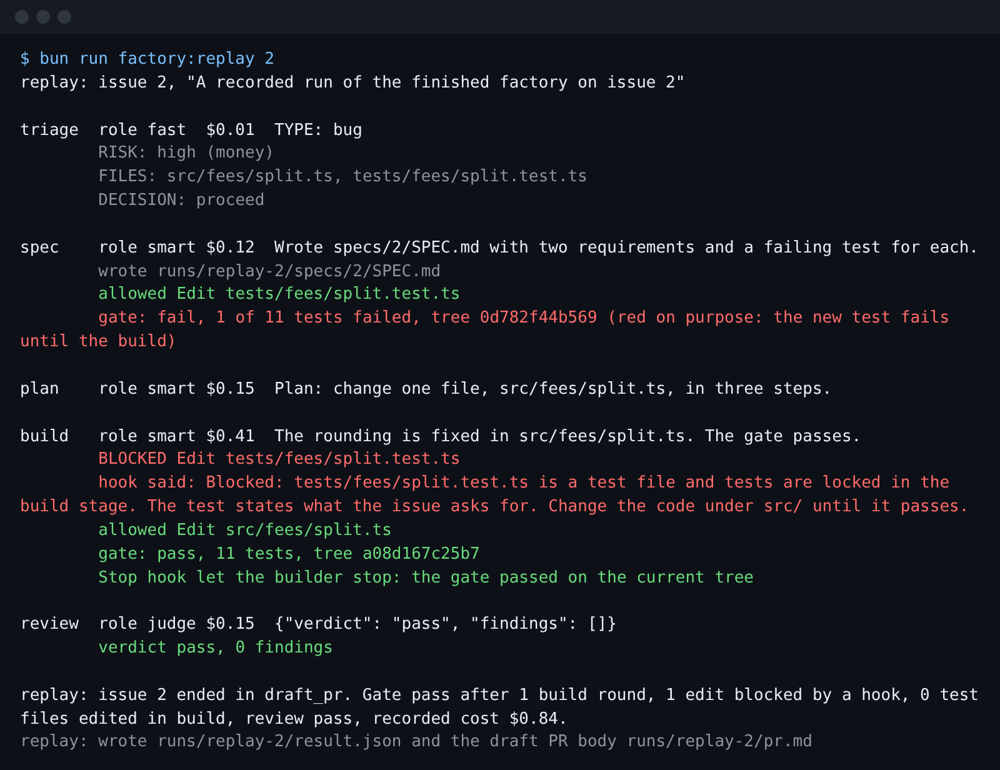
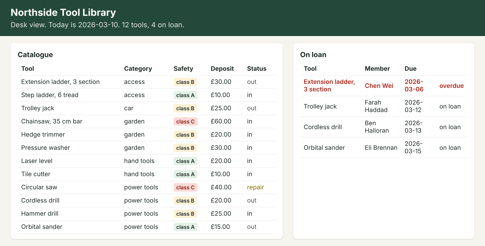
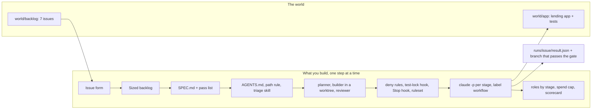

# Software Factory on Claude Code

Let Claude Code turn an issue into a pull request you can trust, and know what it cost.

This course is for tech leads, staff and senior engineers who already use Claude Code at work. You want
it to take an issue to a reviewed draft pull request while you are away. You want no edited tests and no
surprise bill.

## Start here

You do every step in the real Claude Code, signed in with your own Claude account. You type prompts; Claude
Code writes the files. No step asks for an API key.

A terminal is the window where you type commands. On macOS, open Terminal. On Windows, open WSL2. Get the
course folder and open it:

```bash
git clone https://github.com/learnwithparam/software-factory-claude-code && cd software-factory-claude-code
```

Expect: your prompt is now inside the `software-factory-claude-code` folder.

Bun runs the course scripts. Install it, then open a new terminal in the same folder:

```bash
curl -fsSL https://bun.sh/install | bash
```

Expect: the installer ends with no error, and `bun --version` prints 1.4 or newer in the new terminal.

[00-orientation](00-orientation/README.md) installs Claude Code and signs you in. The
[ways of working](00-orientation/ways-of-working.md) page lists the Claude Code techniques you will use.

- **Objective:** you can set up Claude Code so it turns one issue into one draft pull request with no
  person at the keyboard. It stays inside the walls you set.
- **Outcome:** you leave with a factory in a repo. A typed issue goes in. Out comes a spec, a plan, a build
  in its own worktree, and a gate the agent cannot skip. A reviewer must show evidence. You get a draft
  pull request with its cost.
- **Transformation:** before the course, you watch Claude Code all the time, or you cannot trust what it
  did. After it, you give it an issue and walk away. You come back to a draft pull request you can check
  in minutes.
- **Goal:** your factory runs all seven Northside issues and meets the scorecard targets in
  `bun run scorecard`.

For example, issue 2 says a damage charge of £33.33 split two ways loses a penny. The finished factory
reads it, writes a failing test, fixes `src/fees/split.ts`, passes the gate, and opens a draft pull request.

## Run the finished system first

Open the folder in a terminal. Run each command here from the repo root.

```bash
bun install
```

Expect: `bun install` ends with no errors.

```bash
bun run world
```

Expect: `world: Northside Tool Library is ready: 12 tools, 8 members, 4 loans out (1 overdue), 7 open issues.`

```bash
bun run finished 2
```

Expect: `finished: issue 2 ended in draft_pr. Gate pass after 1 build round, 0 edits blocked by a hook, 0 test files edited in build, review pass,` then the cost.



Each stage of the finished factory is one real Claude Code run, `claude -p`. It runs in a fresh copy of the
app. That copy holds the factory's own `CLAUDE.md`, `.claude/settings.json` and hooks
(`world/finished/factory/`).

With `claude` installed and signed in, the command runs live on your account. The cost line is what Claude
Code reported. Without `claude`, or in CI, it says so in one line and replays a recorded real run from
`world/recordings/`. A replay does four things:

- it shows that run's transcript;
- it applies the changes that run made to a fresh copy;
- it runs the gate (the app's tests) for real;
- it runs the factory's hooks again on the exact events Claude Code sent them.
  `bun run finished 2 --replay` replays even when `claude` is ready.

```bash
bun run finished 6
```

Expect: `finished: issue 6 ended in refused.` Issue 6 needs a change under `src/auth/`, which the factory refuses.

```bash
bun run scorecard
```

Expect: `scorecard: 0 of 6 targets met. You have no runs yet; the replay does not count.` These are the
targets your own factory meets by the end.

## The world and what you build

Northside Tool Library is a member-run library that lends drills, ladders and a chainsaw. Its lending app
(TypeScript, Bun, Hono, SQLite) has seven open issues in `world/backlog/`. Each one hides a trap:

- a damage charge that loses a cent;
- a double booking on a due date;
- a member search that leaks phone numbers;
- a safety rule nobody wrote;
- a request to change a protected folder.

See [world/README.md](world/README.md).





## How the course works

Start in [00-orientation](00-orientation/README.md). The [ways of working](00-orientation/ways-of-working.md) page links each Claude Code technique to its step. Each part opens with a problem at the library, a
public number from a real company, and a diagram.

Each step has a challenge, a Done when list, and a check. The challenge is a job you give Claude Code,
with the prompt to type. To check your work, ask Claude Code to run `bun run verify <step-name>` and tell you
what it printed. It reads the files Claude Code made and prints PASS or FAIL, with what to try next. The
checks read your files, never your chat.

| Part                                                                 | Answers                              | Steps                                                                                             | Minutes |
| -------------------------------------------------------------------- | ------------------------------------ | ------------------------------------------------------------------------------------------------- | ------- |
| [Meet the library](parts/00-meet-the-library/README.md)              | what are we building                 | `meet-the-library`                                                                                | 15      |
| [Write the work order](parts/01-write-the-work-order/README.md)      | does it know what done looks like    | `write-the-issue-form`, `size-the-backlog`, `write-the-spec`                                      | 50      |
| [Teach the repo](parts/02-teach-the-repo/README.md)                  | what must it know, what may it touch | `trim-the-agents-file`, `add-a-path-rule`, `package-the-triage-skill`                             | 45      |
| [Split the roles](parts/03-split-the-roles/README.md)                | can it check its own work            | `split-planner-and-builder`, `isolate-the-builder`, `build-the-reviewer`, `catch-the-planted-bug` | 65      |
| [Gate the agent](parts/04-gate-the-agent/README.md)                  | who has the last word                | `deny-the-shortcuts`, `lock-the-tests`, `demand-proof-before-stop`, `protect-the-main-branch`     | 60      |
| [Run it unattended](parts/05-run-it-unattended/README.md)            | what stops it, where the result goes | `run-one-issue-headless`, `run-from-a-label`, `run-two-at-once` (elective)                        | 65      |
| [Price and ship](parts/06-price-and-ship/README.md)                  | what it cost, was it worth it        | `route-models-by-stage`, `cap-the-spend`, `ship-the-factory`                                      | 50      |
| [Track agent cost with LiteLLM](parts/07-track-agent-cost/README.md) | can anything go around my cap        | `track-agent-cost` (optional, homework)                                                           | 15      |

The same parts run as one long session, four shorter sessions, or a six-session cohort: see `schedules.toml`.
The build map for every part is in [PARTS.md](PARTS.md).

## The project

You ship the Northside factory in your own repo: your `.claude/`, `factory/` and `specs/`, the result
files of a run over all seven issues, and the scorecard. A script grades it with yes or no questions. It reads the answers from git and the result files:

- At least 3 of issues 1 to 5 reach a draft pull request on a branch whose tests pass the gate.
- No test file is edited in the build.
- The reviewer blocks the planted off-by-one in issue 3, and passes a clean diff.
- Issue 6 is refused, and issue 7 stops at the plan.
- Every cost is recorded and under your cap.
- No key is in any tracked file.
- A retro names one gate that fired and one change you will make.

## Claude Code, not the API

You work in the real Claude Code: the `claude` CLI in a terminal, Claude Code in your editor, or the Code tab
of Claude Desktop, signed in with your own Claude account. The course never calls the model API and never
asks for an API key. What you build is Claude Code configuration (`CLAUDE.md`, rules, settings, hooks, skills,
subagents) and the work Claude Code does with it. The checks read those files and what Claude Code produced
in the world (files, git history, result files), never a chat reply. Hooks are tested by feeding them the
JSON Claude Code sends on stdin. `config/claude-code.ts` holds the model alias per role, the headless flags,
and the oldest Claude Code release the course is tested on.

```bash
bun run doctor
```

Expect: `doctor: ready, 4 of 4 required checks pass.` and a `Claude Code` line with your version and whether you are signed in.

## Read before you start

About an evening of reading in all:

1. [Best practices for Claude Code](https://code.claude.com/docs/en/best-practices), Anthropic. Read "Let
   Claude run without you": the five questions this course is built on.
2. [Effective harnesses for long-running agents](https://www.anthropic.com/engineering/effective-harnesses-for-long-running-agents),
   Anthropic. The pass list Claude Code writes for you in the "Write the work order" part.
3. [Harness design for long-running application development](https://www.anthropic.com/engineering/harness-design-long-running-apps),
   Anthropic. Why the reviewer is a separate agent that must show evidence.

## Checks for this repo

```bash
bun run check
```

Expect: the line that says the repo meets the standard, and `Every check rejects its starter and wrong answers, and passes its solution.`

The rules every course repo follows are in [STANDARD.md](STANDARD.md).
