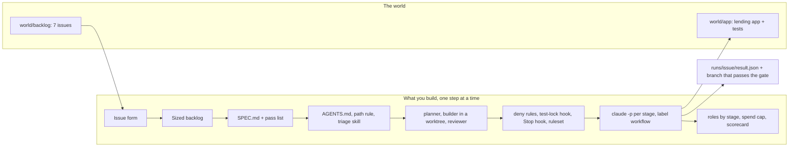

# Software Factory on Claude Code

Let Claude Code turn an issue into a pull request you can trust, and know what it cost.

**For** tech leads, staff and senior engineers who already use Claude Code at work and want it to take an
issue to a reviewed draft pull request while they are away, without edited tests or a surprise bill.

**You leave with** a factory in a repo: a typed issue goes in; a spec, a plan, a build in its own worktree, a
gate the agent cannot skip, a reviewer that must show evidence, and a draft pull request with its cost
come out. Every step is checked by a script you run. No API key is needed until you choose to run live.

## Run the finished system first

```bash
bun install
```

Expect: `bun install` ends with no errors.

```bash
bun run world
```

Expect: `world: Northside Tool Library is ready: 12 tools, 8 members, 4 loans out (1 overdue), 7 open issues.`

```bash
bun run factory:replay 2
```

Expect: `replay: issue 2 ended in draft_pr. Gate pass after 1 build round, 1 edit blocked by a hook, 0 test files edited in build, review pass, recorded cost $0.84.`


The model replies in the replay are recorded. Everything else runs for real: the test-lock hook, the Stop
hook and the gate (the app's tests) all run on a fresh copy of the app.

```bash
bun run scorecard
```

Expect: `scorecard: 0 of 6 targets met. You have no runs yet; the replay does not count.` These are the
targets your own factory meets by the end.

## The world and what you build

Northside Tool Library is a member-run library that lends drills, ladders and a chainsaw. Its lending app
(TypeScript, Bun, Hono, SQLite) has seven open issues in `world/backlog/`, with planted trouble: a damage
charge that loses a cent, a double booking on a due date, a member search that leaks phone numbers, a
safety rule nobody wrote, and a request to change a protected folder. See [world/README.md](world/README.md).




## How the course works

Start in [00-orientation](00-orientation/README.md). Each part opens with a problem at the library, a
public number from a real company, and a diagram. Each step has a challenge, a Done when list, and one
command, `bun run verify <step-name>`, that reads the files you produced and prints PASS or FAIL with what to
try next. You work in the Claude Code CLI; the checks read your files, never your chat.

| Part | Answers | Steps | Minutes |
|---|---|---|---|
| [0. Meet the library](parts/00-meet-the-library/README.md) | what are we building | `meet-the-library` | 15 |
| [1. Write the work order](parts/01-write-the-work-order/README.md) | does it know what done looks like | `write-the-issue-form`, `size-the-backlog`, `write-the-spec` | 50 |
| [2. Teach the repo](parts/02-teach-the-repo/README.md) | what must it know, what may it touch | `trim-the-agents-file`, `add-a-path-rule`, `package-the-triage-skill` | 45 |
| [3. Split the roles](parts/03-split-the-roles/README.md) | can it check its own work | `split-planner-and-builder`, `isolate-the-builder`, `build-the-reviewer`, `catch-the-planted-bug` | 65 |
| [4. Gate the agent](parts/04-gate-the-agent/README.md) | who has the last word | `deny-the-shortcuts`, `lock-the-tests`, `demand-proof-before-stop`, `protect-the-main-branch` | 60 |
| [5. Run it unattended](parts/05-run-it-unattended/README.md) | what stops it, where the result goes | `run-one-issue-headless`, `run-from-a-label`, `run-two-at-once` (elective) | 65 |
| [6. Price and ship](parts/06-price-and-ship/README.md) | what it cost, was it worth it | `route-models-by-stage`, `cap-the-spend`, `ship-the-factory` | 50 |

The same parts run as one long session, four shorter sessions, or a six-session cohort: see `schedules.toml`.
The build map for every part is in [PARTS.md](PARTS.md).

## The project

You ship the Northside factory in your own repo: your `.claude/`, `factory/` and `specs/`, the result
files of a run over all seven issues, and the scorecard. It is graded with yes or no questions a script
answers from git and the result files: at least 3 of issues 1 to 5 reach a draft pull request on a branch
whose tests pass the gate; no test file edited in the build; the reviewer blocked the planted off-by-one in
issue 3 and passed a clean diff; issue 6 refused; issue 7 stopped at the plan; every cost recorded and under
your cap; no key in any tracked file; a retro with one gate that fired and one change you will make.

## Models and keys

Every model call goes through one file, `config/models.ts`, which maps three roles (fast, smart, judge) to
a model per provider. `LLM_PROVIDER` is `replay` by default, so the course, its checks and CI run with no key.
To run live, copy `.env.example` to `.env`, set `LLM_PROVIDER` to `anthropic`, `openrouter` or `openai`, add
that one key, and check it:

```bash
bun run models
```

Expect: `models: every role answers on replay.` (or on the provider you set).

## Read before you start

About 65 minutes of reading in all:

1. [Best practices for Claude Code](https://code.claude.com/docs/en/best-practices), Anthropic. Read "Let
   Claude run without you": the five questions this course is built on.
2. [Effective harnesses for long-running agents](https://www.anthropic.com/engineering/effective-harnesses-for-long-running-agents),
   Anthropic. The pass list you write in Part 1.
3. [Harness design for long-running application development](https://www.anthropic.com/engineering/harness-design-long-running-apps),
   Anthropic. Why the reviewer is a separate agent that must show evidence.

## Checks for this repo

```bash
bun run check
```

Expect: `The repo meets the standard` and `Every check rejects its starter and wrong answers, and passes its solution.`

The rules every course repo follows are in [STANDARD.md](STANDARD.md).
