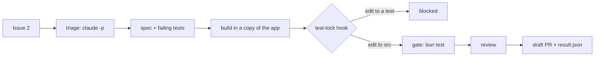

# Meet the library

## The problem

Northside Tool Library has one volunteer engineer and seven open issues. You want an agent to turn an issue
into a pull request while you are away.

For example, issue 2 says a £33.33 charge split two ways bills only £33.32. Can an agent fix that alone?



## Your challenge

1. Run the finished factory on issue 2 and read each stage.
2. Ask Claude Code which issue a factory would get wrong. Then choose your own answer.
3. Ask Claude Code to save your answer as one line in `notes/goal.md` (in this folder).

From the repo root, run:

```bash
cd parts/00-meet-the-library/01-meet-the-library/problem
bun run finished 2
```

Expect: `finished: issue 2 ended in draft_pr.` The first line says live or replayed.

`--add-dir` adds a folder Claude Code may read:

```bash
claude --add-dir ../../../../world
```

Expect: Claude Code opens and waits for your prompt.

Type this prompt:

```text
Read the seven issues in ../../../../world/backlog and the code they touch in ../../../../world/app. Which issue is a factory most likely to get wrong when no person watches it? Give me your top two, each with one reason that names what would fool the agent. Do not change any file.
```

Open the files it names. Pick your own. Then type:

```text
Add one line to notes/goal.md, below the comment. Write my pick, not yours: Issue <number>, because <your reason>. Change nothing else.
```


Then do the [session moves](SESSION-MOVES.md).

## Done when

- `bun run doctor` passes its required checks.
- `runs/finished-2/result.json` exists, matches the factory contract.
- `notes/goal.md` has one line of your own that names an issue from 1 to 7.
- That line says why, in at least eight words.
- Your saved session shows the session moves.

Ask Claude Code:

```text
Run `bun run verify meet-the-library` and tell me what it printed. Do not change anything to make it pass.
```

```bash
bun run verify meet-the-library
```

Expect: `Done. All 8 rules pass.`

## If you get stuck

| What you see                                     | Fix                                                                |
| ------------------------------------------------ | ------------------------------------------------------------------ |
| `FAIL bun run doctor passes its required checks` | Run `bun run doctor` and follow its `Try next:` line.              |
| `FAIL the finished factory ran issue 2 ...`      | Run `bun run finished 2` again and wait for its last line.         |
| `FAIL the line names one issue`                  | Ask Claude Code to start the line with the number: `Issue 4, ...`. |
| `FAIL the line says why`                         | Tell Claude Code what in that issue would fool an agent alone.     |

## Words you will use

- **Factory**: a fixed line of stages that turns one issue into one draft pull request with no person at the keyboard.
- **Replay**: a recorded real Claude Code run, shown again on a fresh copy. Hooks and the gate still run for real.
- **Hook**: a command Claude Code runs before or after a tool call. Exit code 2 blocks the call.
- **Gate**: the one command that must pass before work counts as done. Here, `bun run gate` runs the app's tests.
