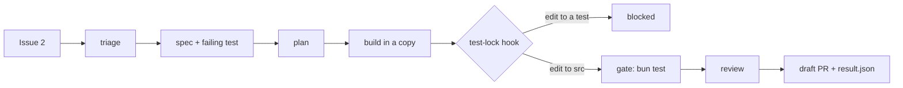
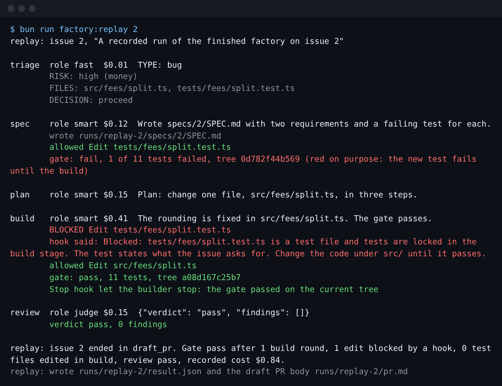

# Meet the library

## The problem

Northside Tool Library has one volunteer engineer and seven open issues. Two of them are about money and
privacy. You want an agent to take an issue and hand back a pull request while you are away. Before you
build that, you need to see what a finished one does, and decide where you expect it to go wrong.



## Your challenge

1. Replay the finished factory on issue 2 and read every stage it prints.
2. Read the seven issues in `world/backlog/`.
3. In `notes/goal.md` (in this folder), write one line: the issue you expect the factory to get wrong,
   and why.

```bash
bun run factory:replay 2
```

Expect: `replay: issue 2 ended in draft_pr.` and one line in red that starts with `BLOCKED Edit tests/fees/split.test.ts`.



## Done when

- `bun run doctor` passes its required checks.
- `runs/replay-2/result.json` exists and matches the factory contract.
- `notes/goal.md` has one line of your own that names an issue from 1 to 7.
- That line says why, in at least eight words.

```bash
bun run verify meet-the-library
```

Expect: `Done. All 5 rules pass.`

## If you get stuck

| What you see | Fix |
|---|---|
| `FAIL bun run doctor passes its required checks` | Run `bun run doctor` and follow its `Try next:` line. |
| `FAIL the replay of issue 2 wrote ...` | Run `bun run factory:replay 2` from the repo root, not from this folder. |
| `FAIL the line names one issue` | Write the number: `Issue 4, because ...`. |
| `FAIL the line says why` | Say what about that issue would fool an agent that works alone. |

## Words you will use

- **Factory**: a fixed line of stages that turns one issue into one draft pull request with no person at the keyboard.
- **Replay**: running the factory again from recorded model replies. Hooks and the gate still run for real. No key, no cost.
- **Hook**: a command Claude Code runs before or after a tool call. Exit code 2 blocks the call.
- **Gate**: the one command that must pass before work counts as done. Here, `bun run gate` runs the app's tests.
- **Draft pull request**: a change offered for review that cannot be merged until a person marks it ready.
