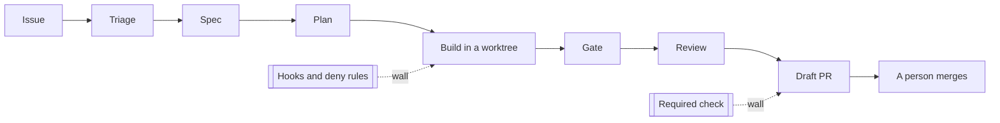

# Part 0: Meet the library

## The problem

The library's only engineer has little time and seven open issues, two of them about money and privacy.
Small issues wait. The engineer is the only gate, so everything waits for them.

Teams that built a factory first got speed and kept control. Rakuten reports a "79% reduction in time to
market" after adopting Claude Code (Anthropic's customer page, a vendor claim, read for this course:
https://claude.com/customers/rakuten). Anthropic's own engineers say the limit is trust, not speed: "more
than half said they can 'fully delegate' only between 0-20% of their work to Claude"
(https://www.anthropic.com/research/how-ai-is-transforming-work-at-anthropic).

This course answers the five questions Anthropic's best-practice page asks before a run goes unattended
(https://code.claude.com/docs/en/best-practices): does it know what done looks like, can it check its own
work, what is it allowed to touch, what stops it, and where does the result go and who signs off. Each part
answers one of them with a file a script can check.



| Step | Minutes | What you produce |
|---|---|---|
| `meet-the-library` | 15 | a passing doctor, a run of the finished factory, `notes/goal.md` |

## Walkthrough

```bash
bun run doctor
```

Expect: `doctor: ready, 4 of 4 required checks pass.` and a line saying whether Claude Code is ready.

```bash
bun run finished 2
```

Expect: `finished: issue 2 ended in draft_pr.`

```bash
bun run verify meet-the-library
```

Expect: `Done. All 5 rules pass.` once `notes/goal.md` names an issue and says why.
