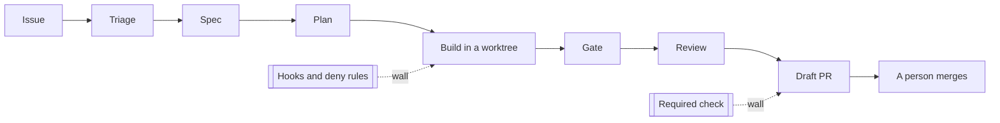

# Meet the library

Moves the **Goal**: you see the finished factory you will build, and the scorecard it must meet.

## The problem

The library's only engineer has little time and seven open issues, two of them about money and privacy.
Small issues wait. The engineer is the only gate, so everything waits for them.

Teams that built a factory first got speed and kept control. Rakuten reports a "79% reduction in time to
market" after adopting Claude Code (Anthropic's customer page, a vendor claim, read for this course:
https://claude.com/customers/rakuten). Anthropic's own engineers say the limit is trust, not speed: "more
than half said they can 'fully delegate' only between 0-20% of their work to Claude"
(https://www.anthropic.com/research/how-ai-is-transforming-work-at-anthropic).

Anthropic's best-practice page asks five questions before a run goes unattended
(https://code.claude.com/docs/en/best-practices):

1. Does it know what done looks like?
2. Can it check its own work?
3. What is it allowed to touch?
4. What stops it?
5. Where does the result go, and who signs off?

Each part answers one of them with a file a script can check. For example, the "Write the work order" part answers the first
question with `specs/5/SPEC.md`, a page that says what done means for issue 5.



| Step               | Minutes | What you produce                                                 |
| ------------------ | ------- | ---------------------------------------------------------------- |
| `meet-the-library` | 15      | a passing doctor, a run of the finished factory, `notes/goal.md` |

## Watch and read

| Kind  | Title                          | Made by                | Why                                                                   | Link                                                            |
| ----- | ------------------------------ | ---------------------- | --------------------------------------------------------------------- | --------------------------------------------------------------- |
| video | Claude Code best practices     | Cal Rueb, Anthropic    | An Anthropic engineer shows how the team uses Claude Code day to day. | https://www.youtube.com/watch?v=gv0WHhKelSE                     |
| video | How We Build Effective Agents  | Barry Zhang, Anthropic | Says when to use an agent and when a simpler flow is enough.          | https://www.youtube.com/watch?v=D7_ipDqhtwk                     |
| read  | Best practices for Claude Code | Anthropic docs         | The five questions this course is built on.                           | https://code.claude.com/docs/en/best-practices                  |
| read  | Building effective agents      | Anthropic engineering  | The plain patterns behind the factory line.                           | https://www.anthropic.com/engineering/building-effective-agents |
| read  | Common workflows               | Anthropic docs         | Short recipes for the first things you will ask Claude Code.          | https://code.claude.com/docs/en/common-workflows                |

## Walkthrough

```bash
bun run doctor
```

Expect: `doctor: ready, 4 of 4 required checks pass.` and a line saying whether Claude Code is ready.

```bash
bun run finished 2
```

Expect: `finished: issue 2 ended in draft_pr.`

Ask Claude Code to check your work. Type:

```text
Run `bun run verify meet-the-library` and tell me what it printed. Do not change anything to make it pass.
```

The raw command is:

```bash
bun run verify meet-the-library
```

Expect: `Done. All 5 rules pass.` once `notes/goal.md` names an issue and says why.

## Go further

Pick a second issue from the seven. Write three lines in `notes/goal.md` on how you think the factory should handle it, then run `bun run finished` on it and compare. The check does not grade this.
