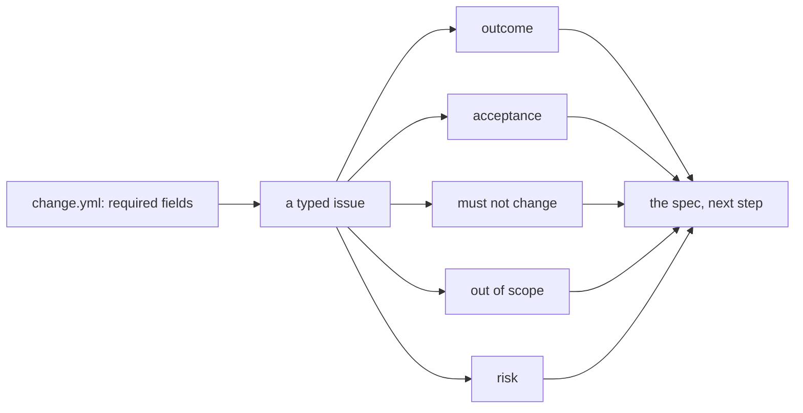

# Write the issue form

## The problem

Issue 5 says, in full: "Only people who did the induction should get the chainsaw." A person at the desk
knows what that means. A factory does not: which tools, which members, what they are told, what must stay
as it is. Today's template has one free text box, so every order arrives this thin.



## Your challenge

Rewrite `.github/ISSUE_TEMPLATE/change.yml` in this folder as a GitHub issue form that makes every order
carry what the factory needs:

- four required textareas with ids `outcome`, `acceptance`, `must-not-change`, `out-of-scope`
- a required dropdown with id `risk` and options `low`, `medium`, `high`

Then test it against a real answer: `world/backlog/answers/5.json` is what the coordinator said when a
volunteer asked about issue 5. Your required ids must match its keys.

Work in the Claude Code CLI if you like: run `claude` in this folder and ask it to read GitHub's issue form
syntax page (link below) and the answers file, then check its draft with the command below. Read every line
it writes; the check reads the file, not the chat.

## Done when

- The file exists and is valid YAML with `name`, `description` and `body`.
- Every field has a label.
- The four textareas exist with those ids and are required.
- `risk` is a required dropdown offering low, medium and high.
- Issue 5's answers fill every required field.

```bash
bun run verify write-the-issue-form
```

Expect: `Done. All 7 rules pass.`


## If you get stuck

| What you see                                | Fix                                                                                |
| ------------------------------------------- | ---------------------------------------------------------------------------------- |
| `FAIL ... is valid YAML`                    | Indent with two spaces. A list item under `body:` starts with `  - type:`.         |
| `FAIL those four textareas are required`    | Add `validations:` then `required: true` under each. GitHub's samples use `false`. |
| `FAIL a required dropdown with id risk ...` | Use `type: dropdown`, not `input`, and list the options under `attributes:`.       |
| `FAIL issue 5's answers fill ...`           | An id is spelled differently from the answers file, such as `must_not_change`.     |

Syntax: https://docs.github.com/en/communities/using-templates-to-encourage-useful-issues-and-pull-requests/syntax-for-issue-forms

## Words you will use

- **Issue form**: a YAML file in `.github/ISSUE_TEMPLATE/` that turns GitHub's new-issue page into a form with typed, required fields.
- **Work order**: an issue complete enough that someone who cannot ask you questions can still finish it.
- **Acceptance line**: one sentence a test can check, such as "Ben Halloran is refused saw-01".
- **Risk**: how bad a mistake would be. High means money, privacy or safety, and a person signs off.
