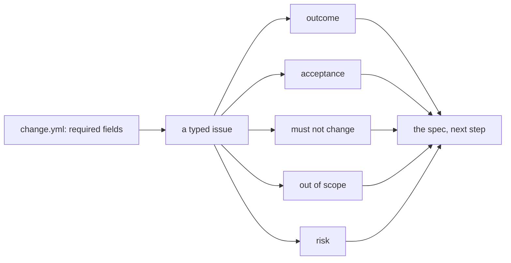
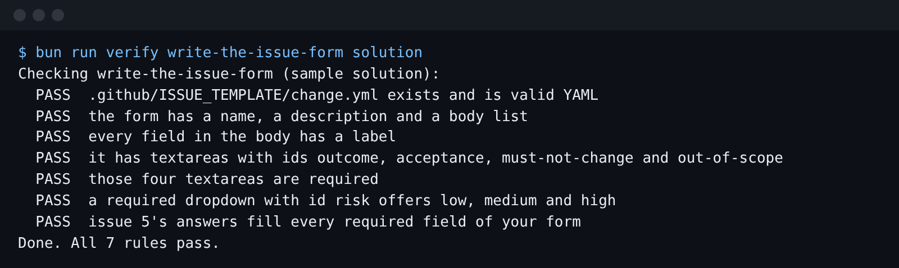

# Write the issue form

## The problem

Issue 5 says, in full: "Only people who did the induction should get the chainsaw."

A person at the desk knows what that means. A factory does not. Which tools? Which members? Today's
template has one free text box, so every order arrives this thin.



## Your challenge

Get Claude Code to turn `.github/ISSUE_TEMPLATE/change.yml` (in this folder) into a GitHub issue form: a
page of boxes a person must fill in.

The form needs:

- four required text boxes (textareas) with the ids `outcome`, `acceptance`, `must-not-change` and
  `out-of-scope`;
- a required dropdown with the id `risk` and the options `low`, `medium` and `high`.

For example, `world/backlog/answers/5.json` holds what the coordinator said about issue 5. Its keys are
`outcome`, `acceptance`, `must-not-change`, `out-of-scope` and `risk`. Your form's ids must match those keys
letter for letter.

Start Claude Code in this folder, so it can also read the world:

```bash
claude --add-dir ../../../../world
```

Expect: Claude Code opens and waits for your prompt.

Type this prompt:

```text
Rewrite .github/ISSUE_TEMPLATE/change.yml as a GitHub issue form for this tool library. It needs four required textareas with the ids outcome, acceptance, must-not-change and out-of-scope, and a required dropdown with the id risk and the options low, medium and high. Every field needs a label. Read ../../../../world/backlog/answers/5.json first: the required ids must match its keys. Show me your plan before you change anything.
```

Read the plan before you say yes. Check each id in the answers file. Check that each field says
`required: true`. If the plan has a part you do not want, say so, then let it write the file.

## Done when

- The file exists and is valid YAML with `name`, `description` and `body`.
- Every field has a label.
- The four textareas exist with those ids and are required.
- `risk` is a required dropdown offering low, medium and high.
- Issue 5's answers fill every required field.

```bash
bun run verify write-the-issue-form
```

Expect: `Done. All 7 rules pass.`



## If you get stuck

| What you see                                | What to tell Claude Code                                                  |
| ------------------------------------------- | ------------------------------------------------------------------------- |
| `FAIL ... is valid YAML`                    | "The file is not valid YAML. Fix the indentation and run the check."      |
| `FAIL those four textareas are required`    | "Add `required: true` under `validations:` for each of the four boxes."   |
| `FAIL a required dropdown with id risk ...` | "Make risk a dropdown, not an input, with the options low, medium, high." |
| `FAIL issue 5's answers fill ...`           | "Compare every id with the keys in answers/5.json and fix the spelling."  |

The prompts and plan from a real run are in `../solution/prompts.md`.

GitHub explains every field type in its [issue form syntax page](https://docs.github.com/en/communities/using-templates-to-encourage-useful-issues-and-pull-requests/syntax-for-issue-forms).

## Words you will use

- **Issue form**: a file in `.github/ISSUE_TEMPLATE/` that makes GitHub's new-issue page a form.
- **Work order**: an issue so full that someone who cannot ask you a thing can still finish it.
- **Acceptance line**: one sentence a test can check, such as "Ben Halloran is refused saw-01".
- **Risk**: how bad a mistake would be. High means money, privacy or safety. Then a person signs off.
