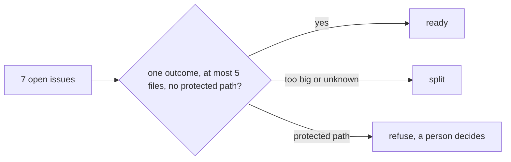

# Size the backlog

## The problem

A factory that starts every issue wastes money on the ones it should never touch.

For example, issue 6 would change who may waive fees. That code lives in `src/auth/`, and only a
coordinator may change it. Issue 7 is an upgrade, and nobody knows yet what it breaks.

Anthropic asked its own engineers how much work they can hand over fully. More than half said 0 to 20%
(https://www.anthropic.com/research/how-ai-is-transforming-work-at-anthropic). Choosing which work to hand
over is the skill.



## Your challenge

Get Claude Code to give each of the seven issues one decision in `factory/backlog.json` (in this folder):
`ready`, `split` or `refuse`, with a `reason`. A `ready` issue also gets an `outcome` and its `files`.

For example, issue 1 is already in the file:

```text
{ "issue": 1, "decision": "ready", "reason": "One docs change ...", "outcome": "...", "files": ["README.md"] }
```

Start Claude Code in this folder:

```bash
claude --add-dir ../../../../world
```

Expect: Claude Code opens and waits for your prompt.

Type this prompt:

```text
Read every issue in ../../../../world/backlog and the app in ../../../../world/app. Then propose one decision for each issue in factory/backlog.json: ready, split or refuse, with a reason. A ready issue also gets an outcome (one sentence a person can check) and files (the 1 to 5 app paths it will change, written as they appear inside world/app). src/auth/ is protected: only a coordinator may change it. Issue 1 is already in the file; follow its shape. Show me your plan before you write the file.
```

Argue with any call you do not agree with, before it writes the file. Then read the file it wrote. Does it
match the plan? The check accepts some answers you should still reject.

## Done when

- `factory/backlog.json` is a list with exactly one entry for each issue, 1 to 7.
- Each decision is `ready`, `split` or `refuse`, with a reason of five words or more.
- Issue 6 is refused, and the reason names the protected path.
- Issue 7 is not ready as one piece.
- Every ready issue has an outcome and 1 to 5 files that exist in the app (or a new test under `tests/`).
- No ready issue touches a protected path.

```bash
bun run verify size-the-backlog
```

Expect: `Done. All 8 rules pass.`


## If you get stuck

| What you see                                        | What to tell Claude Code                                       |
| --------------------------------------------------- | -------------------------------------------------------------- |
| `FAIL factory/backlog.json is a JSON list`          | "The file must be a JSON list. Fix it and run the check."      |
| `FAIL every issue ... has exactly one entry`        | "Give each issue from 1 to 7 exactly one entry."               |
| `FAIL every file a ready issue names is in the app` | "Write paths as src/fees/split.ts, not world/app/src/..."      |
| `FAIL issue 6 is refused ...`                       | "Refuse issue 6, and name the protected folder in the reason." |

The full prompts, the plan Claude Code showed in a real run, and where to steer it are in
`../solution/prompts.md`.

## Words you will use

- **Ready**: one outcome, a short list of files, nothing protected. The factory may start it.
- **Split**: real work, but too big or too unknown for one run. It becomes smaller issues first.
- **Refuse**: the factory must not start it. A person decides, here a coordinator.
- **Protected path**: a folder where every change needs a named person's review, here `src/auth/`.
