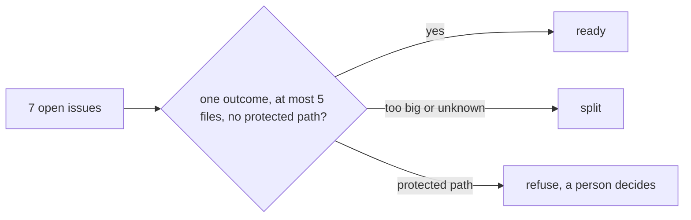
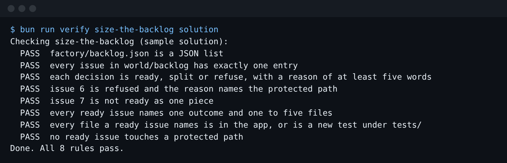

# Size the backlog

## The problem

A factory that starts every issue wastes money on the ones it should never touch. Issue 6 would change who
may waive fees, in `src/auth/`, which only a coordinator may change. Issue 7 is an upgrade whose breakage
nobody knows yet. Anthropic found that more than half of its own engineers can "fully delegate" only 0 to 20%
of their work (https://www.anthropic.com/research/how-ai-is-transforming-work-at-anthropic). Choosing which
work to hand over is the skill.



## Your challenge

Read every issue in `world/backlog/` and the app in `world/app/`. In `factory/backlog.json` (in this folder),
give each issue one decision: `ready`, `split` or `refuse`, with a `reason`. A `ready` issue also gets an
`outcome` (one sentence a person can check) and `files` (the 1 to 5 app paths it will change).

Issue 1 is done for you as an example. Paths are written as they appear inside `world/app/`.

In the Claude Code CLI you can ask: "Read world/backlog and world/app, then propose a decision for each
issue in the shape of factory/backlog.json. Do not write the file." Then write it yourself and argue with
any decision you disagree with.

## Done when

- `factory/backlog.json` is a list with exactly one entry for each issue, 1 to 7.
- Each decision is `ready`, `split` or `refuse`, with a reason of five words or more.
- Issue 6 is refused, and the reason names the protected path.
- Issue 7 is not ready as one piece.
- Every ready issue has an outcome and 1 to 5 files that exist in the app (or a new test under `tests/`).
- No ready issue touches a protected path.

```bash
bun run verify size-the-backlog
```

Expect: `Done. All 8 rules pass.`



## If you get stuck

| What you see                                        | Fix                                                            |
| --------------------------------------------------- | -------------------------------------------------------------- |
| `FAIL factory/backlog.json is a JSON list`          | The file must start with `[`. A trailing comma breaks JSON.    |
| `FAIL every issue ... has exactly one entry`        | Count your entries: 1 to 7, each once.                         |
| `FAIL every file a ready issue names is in the app` | Write `src/fees/split.ts`, not `world/app/src/fees/split.ts`.  |
| `FAIL issue 6 is refused ...`                       | Which folder does issue 6 name? Put that folder in the reason. |

## Words you will use

- **Ready**: one outcome, a short list of files, nothing protected. The factory may start it.
- **Split**: real work, but too big or too unknown for one run. It becomes smaller issues first.
- **Refuse**: the factory must not start it. A person decides, here a coordinator.
- **Protected path**: a folder where every change needs a named person's review, here `src/auth/`.
