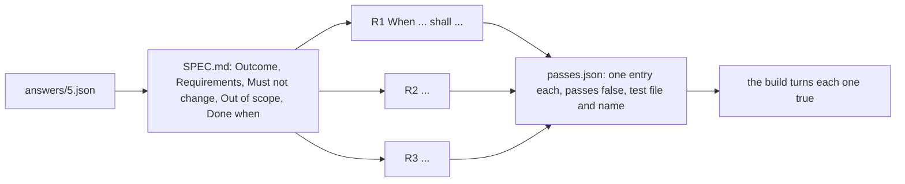

# Write the spec

## The problem

The issue form gives the factory the coordinator's answers. The factory still needs lines a test can
prove, and a way to know when it is finished. Without them, the builder decides what done means. Then the
reviewer argues about it later.

Anthropic's harness for long runs keeps a list of features. Every feature starts as failing. The agent may
only mark one as passing when its test passes
(https://www.anthropic.com/engineering/effective-harnesses-for-long-running-agents). You make that list.



## Your challenge

Get Claude Code to write `specs/5/SPEC.md` and `specs/5/passes.json` (in this folder) for the chainsaw
rule. A spec is one page that says what done means for one issue.

Each requirement is one EARS line. EARS is a fixed way to write a requirement: it opens with When, While,
If, Where or "The system shall", and says `shall` once.

For example, the worked spec in `specs/3/SPEC.md` has this line:

```text
- R1. When a reservation starts on the due date of an open loan of the same item, the system shall report a clash.
```

Start Claude Code in this folder:

```bash
claude --add-dir ../../../../world
```

Expect: Claude Code opens and waits for your prompt.

Type this prompt:

```text
Read specs/3/ as a worked example. Then read issue 5 in ../../../../world/backlog and the coordinator's answers in ../../../../world/backlog/answers/5.json. Write specs/5/SPEC.md in the same shape as specs/3/SPEC.md. Write each requirement as one EARS line that starts with When, While, If, Where or The system shall, numbered R1, R2 and on. Then write specs/5/passes.json with one entry per requirement: id, requirement, test_file, test_name and passes set to false. Show me your plan before you write anything.
```

You can also ask it to interview you, one question at a time. Answer from `answers/5.json`.

Read each line of the plan. Does each requirement start with an EARS word? Does each test file sit next to
the code it tests? Steer it before it writes.

## Done when

- SPEC.md has the five sections, each with text.
- Requirements has at least three lines, R1 to R3 or more.
- Every requirement opens with an EARS keyword and says shall.
- The requirements cover class C tools, the induction, and the reason the member is told.
- `passes.json` has exactly one entry per requirement id.
- Every entry starts with `"passes": false` and names a test file under `tests/` and a test name.

```bash
bun run verify write-the-spec
```

Expect: `Done. All 7 rules pass.`

## If you get stuck

| What you see                                        | What to tell Claude Code                                                  |
| --------------------------------------------------- | ------------------------------------------------------------------------- |
| `FAIL ... has Outcome, Requirements ...`            | "Use the five headings of specs/3/SPEC.md exactly, with text under each." |
| `FAIL Requirements lists at least three lines`      | "Start each requirement line with its id: - R1. "                         |
| `FAIL every requirement opens with an EARS keyword` | "Rewrite each requirement as: When ..., the system shall ..."             |
| `FAIL every pass entry starts with passes: false`   | "Nothing is built yet. Set passes to false in every entry."               |

The full prompts, the plan Claude Code showed in a real run, and where to steer it are in
`../solution/prompts.md`.

EARS was first described by Alistair Mavin and colleagues at Rolls-Royce: https://alistairmavin.com/ears/

## Words you will use

- **Spec**: one page that says what done means for one issue, written before any code.
- **EARS**: Easy Approach to Requirements Syntax. Each requirement opens with a fixed keyword, so it reads as a condition and a response.
- **Pass list**: `passes.json`, one entry per requirement, each starting false. The factory may only flip `passes`.
- **Must not change**: behaviour the change must leave exactly as it was. A reviewer checks it.
