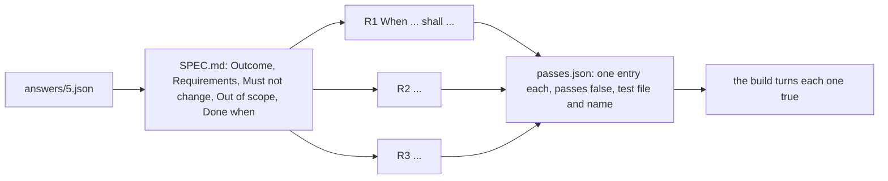

# Write the spec

## The problem

The issue form gives the factory the coordinator's answers. It still has to turn them into lines a test can
prove, and it needs a way to know when it is finished. Without that, the builder decides what done means,
and the reviewer argues about it later in review comments.

Anthropic's harness for long runs keeps a list where every feature starts as failing and the agent may only
flip that field when its test passes
(https://www.anthropic.com/engineering/effective-harnesses-for-long-running-agents). You will write that list.



## Your challenge

Write `specs/5/SPEC.md` and `specs/5/passes.json` in this folder for the chainsaw rule.

1. Read the worked example in `specs/3/`. Copy its shape, not its words.
2. Read issue 5 in `world/backlog/` and the coordinator's answers in `world/backlog/answers/5.json`.
3. Write each requirement as one EARS line: it opens with When, While, If, Where, or "The system shall",
   and says `shall` once. Number them R1, R2, R3 and on.
4. For each requirement, add one entry to `passes.json` with `id`, `requirement`, `test_file`, `test_name`
   and `"passes": false`.

Try the interview pattern in the Claude Code CLI: run `claude` here and say "Interview me about issue 5,
one question at a time, then write specs/5/SPEC.md in the shape of specs/3/SPEC.md." Answer from the
answers file. Check what it wrote against the rules below; the check reads the files only.

## Done when

- SPEC.md has the five sections, each with text.
- Requirements has at least three lines, R1 to R3 or more.
- Every requirement opens with an EARS keyword and says shall.
- The requirements cover class C tools, the induction, and the reason the member is told.
- `passes.json` has exactly one entry per requirement id.
- Every entry starts with `"passes": false` and names a test file under `tests/` and a test name.

```bash
bun run verify write-the-spec
```

Expect: `Done. All 7 rules pass.`

## If you get stuck

| What you see                                        | Fix                                                                                                             |
| --------------------------------------------------- | --------------------------------------------------------------------------------------------------------------- |
| `FAIL ... has Outcome, Requirements ...`            | Use `## Outcome` and the other four headings exactly, with text under each.                                     |
| `FAIL Requirements lists at least three lines`      | Start each line `- R1. ` with the id first.                                                                     |
| `FAIL every requirement opens with an EARS keyword` | "Inducted members can take class C tools" has no trigger. Write "When a member with ..., the system shall ...". |
| `FAIL every pass entry starts with passes: false`   | Nothing is built yet, so nothing passes. Only a green test may flip it.                                         |

EARS was first described by Alistair Mavin and colleagues at Rolls-Royce: https://alistairmavin.com/ears/

## Words you will use

- **Spec**: one page that says what done means for one issue, written before any code.
- **EARS**: Easy Approach to Requirements Syntax. Each requirement opens with a fixed keyword, so it reads as a condition and a response.
- **Pass list**: `passes.json`, one entry per requirement, each starting false. The factory may only flip `passes`.
- **Must not change**: behaviour the change has to leave exactly as it was. A reviewer checks it.
