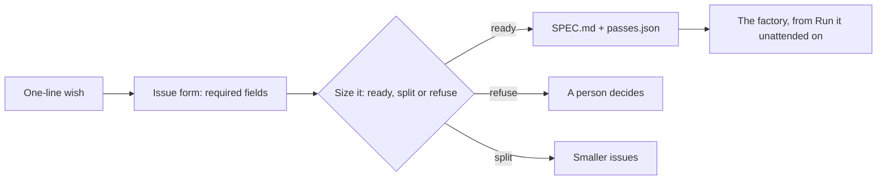

# Write the work order

Moves the **Outcome**: the typed issue and the spec that go into your factory.

Answers the question: **does it know what done looks like?**

## The problem

A vague issue makes a vague pull request. For example, issue 5 at Northside is one line: "Only people who
did the induction should get the chainsaw."

An agent working alone will guess. Which tools? Which members? What is the refused member told? Then the
reviewer fixes the spec in review comments, one round at a time.

## Why it matters

Stripe "Migrated 10,000 lines of Scala to Java" with Claude Code (Anthropic's customer page, a vendor claim:
https://claude.com/customers/stripe). Work that size goes through because the target is exact: the old code
says what the new code must do. Anthropic's own engineers say that more than half of them can "fully
delegate" only between 0 and 20% of their work
(https://www.anthropic.com/research/how-ai-is-transforming-work-at-anthropic). The work you can hand over is
the work you can describe exactly. This part makes the description a file the factory reads.



| Step                   | Minutes | What you produce                                                    |
| ---------------------- | ------- | ------------------------------------------------------------------- |
| `write-the-issue-form` | 15      | `.github/ISSUE_TEMPLATE/change.yml` with required fields            |
| `size-the-backlog`     | 10      | `factory/backlog.json`: ready, split or refuse for all seven issues |
| `write-the-spec`       | 25      | `specs/5/SPEC.md` with EARS requirements and `specs/5/passes.json`  |

Each step's files go in that step's `problem/` folder. You start Claude Code there, give it the job, read its
plan, and check what it wrote. Each step's `solution/prompts.md` shows the prompts from a real run.

## Walkthrough

```bash
bun run verify write-the-issue-form
```

Expect: `Done. All 7 rules pass.`

```bash
bun run verify size-the-backlog
```

Expect: `Done. All 8 rules pass.`

```bash
bun run verify write-the-spec
```

Expect: `Done. All 7 rules pass.`

```bash
bun run verify part write-the-work-order
```

Expect: `Part write-the-work-order is done: 3/3 steps pass.`

Compare with the sample answers at any time, for example `bun run verify write-the-spec solution`.

## Go further

Take an issue you wrote for your own project. Turn it into a typed issue and a spec in the same shape. Ask a friend to say what done looks like from the spec alone. The check does not grade this.
