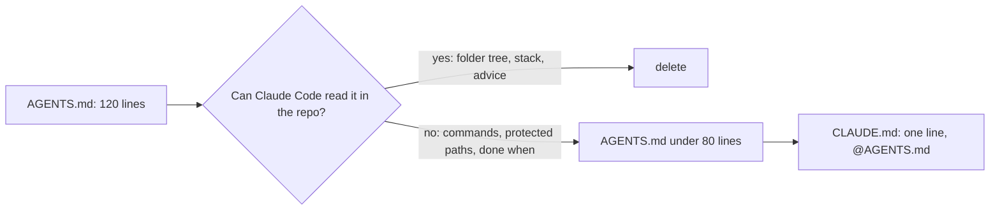
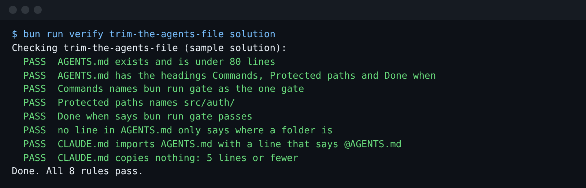

# Trim the agents file

## The problem

Claude Code reads `AGENTS.md` at the start of each session. It reads every line, every time.

A long file costs more. Each line uses tokens. A token is a small piece of text, and you pay for each one. A long file can also bury the rules that matter, so Claude may skip them.

This repo's `AGENTS.md` is 120 lines long. Most lines describe the folders. Those lines go out of date. `CLAUDE.md` copies half of them again, so one rule lives in two files.

Anthropic's best-practice page says: "Claude reads the repo itself. Only write down what isn't in there."
(https://code.claude.com/docs/en/best-practices)

## Words you will use

- **AGENTS.md**: a file of instructions for coding agents. Many tools read it, not only Claude Code.
- **CLAUDE.md**: the file Claude Code reads first. It can load another file with a line such as `@AGENTS.md`.
- **Import**: a line in `CLAUDE.md` that loads another file in its place.
- **Token**: a small piece of text. You pay for each one.
- **Protected path**: a folder the factory must never change, such as `src/auth/`.
- **Gate**: the one command that runs every test. Here it is `bun run gate`.
- **Check**: a script that tests your work. It prints each rule and whether it passed.

## The picture

Each line in `AGENTS.md` gets one question: can Claude Code find this in the repo itself?



## Your challenge

Cut `AGENTS.md` down to what only you know. Then make `CLAUDE.md` load it. Each rule then lives in one file.

Start Claude Code in this step's `problem/` folder. The check reads your work from there.

```bash
cd parts/02-teach-the-repo/01-trim-the-agents-file/problem
claude --add-dir ../../../../world
```

Expect: Claude Code opens and waits for your prompt.

Paste this prompt. It has one instruction per sentence:

```text
Read AGENTS.md and CLAUDE.md. The app they describe is in ../../../../world/app. Make AGENTS.md short. Delete every line that you could learn by reading the repo yourself: the folder tree, what each folder holds, the tech stack, and general advice like "write clean code". Keep three headings: Commands, Protected paths and Done when. Keep bun run gate as the one gate, and keep src/auth/ as a protected path. Drop the Money section for now: the next step gives it a rule file of its own. Keep AGENTS.md under 80 lines, in short plain sentences. Then make CLAUDE.md one line: @AGENTS.md. Show me your plan before you change anything.
```

For example, a line like `src/ holds the fee code` is one Claude Code can learn by reading the repo. Delete it. A line like `bun run gate runs every test` is one Claude Code cannot learn by reading. Keep it.

1. Run the `cd` and `claude` commands above.
2. Paste the prompt.
3. Read the plan. Check that it keeps `bun run gate` and `src/auth/`.
4. Tell Claude Code to go ahead.
5. Run the check below.

Then do the [session moves](SESSION-MOVES.md).

## Done when

- `AGENTS.md` is under 80 lines.
- It has the headings Commands, Protected paths and Done when.
- Commands and Done when both name `bun run gate`.
- Protected paths names `src/auth/`.
- No line only says where a folder is.
- `CLAUDE.md` holds the line `@AGENTS.md` and nothing it copies.
- Your saved session shows the session moves.

## Check your work

Ask Claude Code:

```text
Run `bun run verify trim-the-agents-file` and tell me what it printed. Do not change anything to make it pass.
```

Or run it yourself:

```bash
bun run verify trim-the-agents-file
```

Expect: `Done. All 9 rules pass.`



## If you get stuck

| What you see                                     | What to tell Claude Code                                   |
| ------------------------------------------------ | ---------------------------------------------------------- |
| `FAIL  no line in AGENTS.md only says where ...` | "Delete every line that says what a folder holds."         |
| `FAIL  Protected paths names src/auth/`          | "Keep a Protected paths heading. src/auth/ goes under it." |
| `FAIL  CLAUDE.md imports AGENTS.md ...`          | "Make CLAUDE.md one line: @AGENTS.md."                     |
