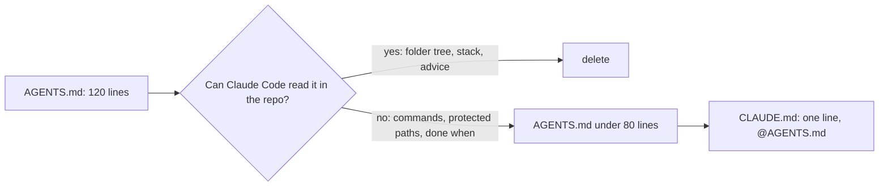
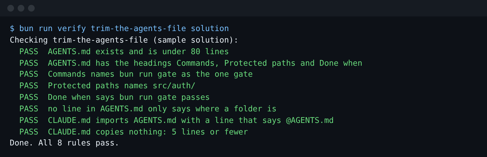

# Trim the agents file

## The problem

Claude Code reads `CLAUDE.md` at the start of every session. Every line in it costs tokens on every turn.

The library's `AGENTS.md` in this folder is 120 lines long. Most of it tells Claude Code what it can see for
itself. For example, it lists the folder tree and says `src/fees/` holds fees. `CLAUDE.md` then copies half
of it again, so the same rule lives in two places.

Anthropic's best-practice page says: "Claude reads the repo itself. Only write down what isn't in there."
(https://code.claude.com/docs/en/best-practices)



## Your challenge

Get Claude Code to cut `AGENTS.md` down to what only you know. Then make `CLAUDE.md` import it.

An import is a line that starts with `@` and names a file. Claude Code reads that file in its place. So the
rules live in one file, and both names point at it.

Start Claude Code in this folder:

```bash
claude --add-dir ../../../../world
```

Expect: Claude Code opens and waits for your prompt.

Type this prompt:

```text
Read AGENTS.md and CLAUDE.md. The app they describe is in ../../../../world/app. Make AGENTS.md short. Delete every line that you could learn by reading the repo yourself: the folder tree, what each folder holds, the tech stack, and general advice like "write clean code". Keep three headings: Commands, Protected paths and Done when. Keep bun run gate as the one gate, and keep src/auth/ as a protected path. Drop the Money section for now: the next step gives it a rule file of its own. Keep AGENTS.md under 80 lines, in short plain sentences. Then make CLAUDE.md one line: @AGENTS.md. Show me your plan before you change anything.
```

Read the plan. Check that it keeps `bun run gate` and `src/auth/`. Then tell it to go ahead, and to
run the check.

## Done when

- `AGENTS.md` is under 80 lines.
- It has the headings Commands, Protected paths and Done when.
- Commands and Done when both name `bun run gate`.
- Protected paths names `src/auth/`.
- No line only says where a folder is.
- `CLAUDE.md` holds the line `@AGENTS.md` and nothing it copies.

```bash
bun run verify trim-the-agents-file
```

Expect: `Done. All 8 rules pass.`



## If you get stuck

| What you see                                     | What to tell Claude Code                                   |
| ------------------------------------------------ | ---------------------------------------------------------- |
| `FAIL  no line in AGENTS.md only says where ...` | "Delete every line that says what a folder holds."         |
| `FAIL  Protected paths names src/auth/`          | "Keep a Protected paths heading. src/auth/ goes under it." |
| `FAIL  CLAUDE.md imports AGENTS.md ...`          | "Make CLAUDE.md one line: @AGENTS.md."                     |

The prompts and the plan from a real run are in `../solution/prompts.md`.

## Words you will use

- **AGENTS.md**: an instructions file for coding agents. Many tools read it, not only Claude Code.
- **Import**: a line like `@AGENTS.md` in `CLAUDE.md`. Claude Code reads the named file in its place.
- **Token**: a small piece of text. Every token in `CLAUDE.md` is sent on every turn, and you pay for it.
- **Protected path**: a folder the factory must never change, such as `src/auth/`.
