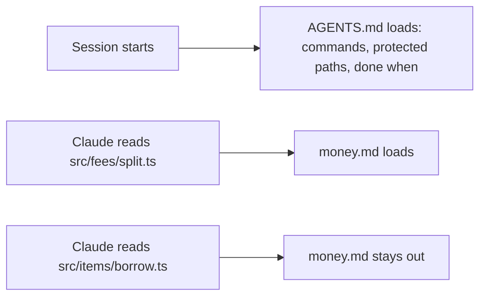

# Add a path rule

## The problem

In the last step you removed the money section from `AGENTS.md`. The money rule still matters, but only in the fee code.

For example, `splitCharge` in `src/fees/split.ts` splits a fee for damaged items between members. Members are the people who borrow items. The code stores every amount in whole cents. So £33.33 is stored as 3333.

Why not decimals? A float is a number with a decimal point, such as 33.33. Floats can round a penny the wrong way. Whole cents never do.

If the rule stays in `AGENTS.md`, every session reads it. That includes a session about member search, which has no money in it.

## Words you will use

- **Path rule**: a Markdown file in `.claude/rules/`. It loads only when Claude Code reads a matching file.
- **Paths**: the list of file patterns in a path rule. The list sits in the frontmatter.
- **Frontmatter**: settings at the top of a Markdown file, between two `---` lines.
- **Glob**: a file pattern. `**` means any folder, at any depth. So `src/fees/**` means every file under `src/fees/`.
- **Integer cents**: money kept as a whole number of cents.
- **Check**: a script that tests your work. It prints each rule and whether it passed.

## The picture

`AGENTS.md` loads in every session. The money rule loads only when Claude Code reads a fee file.



## Your challenge

Write `.claude/rules/money.md` in this folder. It holds the money rule and a `paths` list. The list goes in the frontmatter, at the top of the file.

The factory runs the app from the top of the repo. So the paths start at `src/`, not at `world/app/`.

For example, `src/fees/split.ts` matches `src/fees/**`. `src/items/borrow.ts` does not match it, so the rule stays out of item code.

Start Claude Code in this step's `problem/` folder. The check reads your work from there.

```bash
cd parts/02-teach-the-repo/02-add-a-path-rule/problem
claude --add-dir ../../../../world
```

Expect: Claude Code opens and waits for your prompt.

Paste this prompt. It has one instruction per sentence:

```text
Read the money code in ../../../../world/app/src/fees and its tests. Then add a path rule at .claude/rules/money.md. It must load only when you read or edit a file in src/fees/. In the factory the app sits at the repo root, so the paths start at src/, not at world/app/. The rule says every amount is in integer cents, never a float, and names the test file tests/fees/split.test.ts. Keep it under 10 lines, in short plain sentences. Show me your plan before you write anything.
```

1. Run the `cd` and `claude` commands above.
2. Paste the prompt.
3. Read the plan. Check the glob. `src/fees/**` is right. `src/**` is too wide, because it would load the rule for `src/items/` too.
4. Tell Claude Code to go ahead. It asks before it writes under `.claude/`. Approve that write.
5. Run the check below.

## Done when

- `money.md` starts with frontmatter that holds a `paths` list.
- A glob matches `src/fees/split.ts` and `src/fees/late.ts`.
- No glob matches app code outside `src/fees/` and `tests/fees/`.
- The rule says amounts are integer cents, and names `tests/fees/split.test.ts`.
- The rule is short: under 30 lines.

## Check your work

Ask Claude Code:

```text
Run `bun run verify add-a-path-rule` and tell me what it printed. Do not change anything to make it pass.
```

Or run it yourself:

```bash
bun run verify add-a-path-rule
```

Expect: `Done. All 6 rules pass.`

## If you get stuck

| What you see                                           | What to tell Claude Code                             |
| ------------------------------------------------------ | ---------------------------------------------------- |
| `FAIL  .claude/rules/money.md has frontmatter ...`     | "Start the file with a --- block that holds paths:." |
| `FAIL  a paths glob matches src/fees/split.ts ...`     | "The app is at the repo root. Use src/fees/**."      |
| `FAIL  no glob matches app code outside src/fees/ ...` | "Narrow the glob to src/fees/**."                    |

The prompts and the plan from a real run are in `../solution/prompts.md`. The rule format is on
https://code.claude.com/docs/en/memory under "Path-specific rules".
