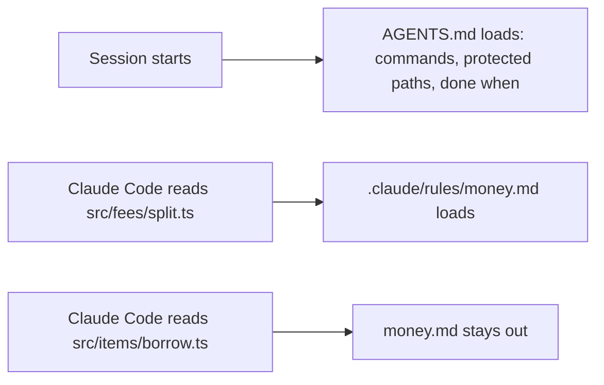

# Add a path rule

## The problem

The money rule left `AGENTS.md` in the last step. It still matters, but only in one place. For example,
`splitCharge` in `src/fees/split.ts` shares a damage charge in integer cents: £33.33 is stored as 3333.
A float there loses a penny.

If the rule sits in `AGENTS.md`, you pay for it in every session, even one about member search. A path
rule fixes that. It loads only when Claude Code reads or edits a file that matches its `paths`.



## Your challenge

Get Claude Code to write `.claude/rules/money.md` in this folder. It holds the money rule and a `paths`
list in its frontmatter. Frontmatter is the block between two `---` lines at the top of the file.

In the factory, the app sits at the root of the repo. So the paths start at `src/`, not at `world/app/`.

Start Claude Code in this folder:

```bash
claude --add-dir ../../../../world
```

Expect: Claude Code opens and waits for your prompt.

Type this prompt:

```text
Read the money code in ../../../../world/app/src/fees and its tests. Then add a path rule at .claude/rules/money.md. It must load only when you read or edit a file in src/fees/. In the factory the app sits at the repo root, so the paths start at src/, not at world/app/. The rule says every amount is in integer cents, never a float, and names the test file tests/fees/split.test.ts. Keep it under 10 lines, in short plain sentences. Show me your plan before you write anything.
```

Read the plan. Check the glob: `src/fees/**` is right, `src/**` is too wide. Then tell it to go ahead.
Claude Code asks before it writes anything under `.claude/`. Approve that write.

## Done when

- `money.md` starts with frontmatter that holds a `paths` list.
- A glob matches `src/fees/split.ts` and `src/fees/late.ts`.
- No glob matches app code outside `src/fees/` and `tests/fees/`.
- The rule says amounts are integer cents, and names `tests/fees/split.test.ts`.
- The rule is short: under 30 lines.

```bash
bun run verify add-a-path-rule
```

Expect: `Done. All 6 rules pass.`

## If you get stuck

| What you see                                           | What to tell Claude Code                             |
| ------------------------------------------------------ | ---------------------------------------------------- |
| `FAIL  .claude/rules/money.md has frontmatter ...`     | "Start the file with a --- block that holds paths:." |
| `FAIL  a paths glob matches src/fees/split.ts ...`     | "The app is at the repo root. Use src/fees/**."      |
| `FAIL  no glob matches app code outside src/fees/ ...` | "Narrow the glob to src/fees/**."                    |

The prompts and the plan from a real run are in `../solution/prompts.md`. The rule format is on
https://code.claude.com/docs/en/memory under "Path-specific rules".

## Words you will use

- **Path rule**: a Markdown file in `.claude/rules/` with a `paths` list. It loads only for matching files.
- **Glob**: a file pattern. `src/fees/**` means every file under `src/fees/`.
- **Frontmatter**: settings at the top of a Markdown file, between two `---` lines.
- **Integer cents**: money kept as a whole number of cents, so no rounding error can creep in.
