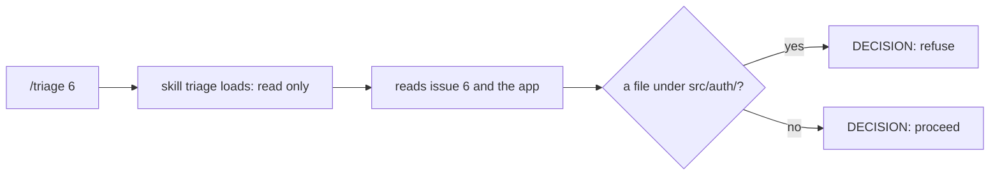
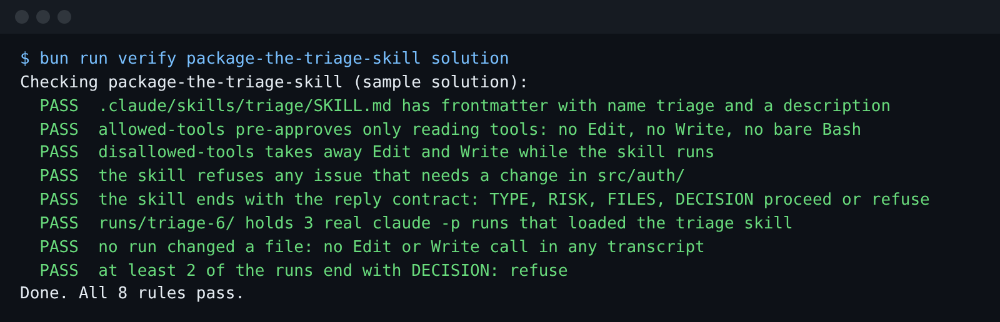

# Package the triage skill

## The problem

The factory must first decide if an issue is safe to start. That first check is called triage.

For example, issue 6 asks to let desk volunteers waive any fee. To waive a fee means to cancel it. The rule for that lives in `src/auth/roles.ts`. The folder `src/auth/` is protected. So triage must refuse issue 6.

Triage must refuse it on each run. Claude Code can answer a little differently each time. So the check needs at least two of the three runs to refuse.

## Words you will use

- **Triage**: the factory's first check. It decides if an issue is safe to start.
- **Skill**: a `SKILL.md` file in `.claude/skills/<name>/`. You run it by typing `/<name>`.
- **allowed-tools**: the tools the skill may use without asking you.
- **disallowed-tools**: the tools the skill may not use. Here, they stop it from editing files.
- **Reply contract**: a fixed reply format, such as `DECISION: refuse`, that a script can read.
- **Plan**: the list of changes Claude Code proposes before it edits any file.
- **Check**: a script that tests your work. It prints each rule and whether it passed.

## The picture

Triage reads issue 6 and answers one question. It asks whether the change would touch a file in `src/auth/`.



## Your challenge

Write `.claude/skills/triage/SKILL.md` in this folder.

Start Claude Code in this step's `problem/` folder. The check reads your work from there.

```bash
cd parts/02-teach-the-repo/03-package-the-triage-skill/problem
claude --add-dir ../../../../world
```

Expect: Claude Code opens and waits for your prompt.

Paste this prompt. It has one instruction per sentence:

```text
Write a skill at .claude/skills/triage/SKILL.md that decides if one backlog issue is safe for the factory to start. I run it as /triage 6, where 6 is the issue number. The issues are files in ../../../../world/backlog, named like 6-volunteers-waive-fees.md. The app is in ../../../../world/app. The skill reads the issue and finds the files the change would touch. It refuses any issue that needs a change in src/auth/, the protected path in AGENTS.md. The skill only reads: set allowed-tools to Read, Grep and Glob, and set disallowed-tools to Edit and Write. End the skill with a fixed reply of four lines: TYPE: bug, feature, docs or deps. RISK: low, medium or high. FILES: the files it would touch. DECISION: proceed or refuse, then the reason. Use short plain sentences. Show me your plan before you write anything.
```

1. Run the `cd` and `claude` commands above.
2. Paste the prompt.
3. Read the plan. Check that the skill only reads files.
4. Approve the plan, then type `/exit`.
5. Run the skill three times and save each run, as the next block shows.

The next command runs the skill three times. Each run is saved as a log. The log is a text file with one JSON line for each step Claude Code takes. JSON is a plain text format for data. The check reads these logs.

```bash
mkdir -p runs/triage-6 && for run in 1 2 3; do claude -p "/triage 6" --add-dir ../../../../world --output-format stream-json --verbose --setting-sources project,local --no-session-persistence > runs/triage-6/run-$run.jsonl; done
```

Expect: no output. `runs/triage-6/` then holds `run-1.jsonl`, `run-2.jsonl` and `run-3.jsonl`.

## Done when

- `SKILL.md` has `name: triage` and a description.
- `allowed-tools` lists only reading tools, and `disallowed-tools` takes away Edit and Write.
- The skill refuses a change in `src/auth/` and ends with the four reply lines.
- Three real runs loaded the skill, changed no file, and at least two end with `DECISION: refuse`.

## Check your work

Ask Claude Code:

```text
Run `bun run verify package-the-triage-skill` and tell me what it printed. Do not change anything to make it pass.
```

Or run it yourself:

```bash
bun run verify package-the-triage-skill
```

Expect: `Done. All 8 rules pass.`



## If you get stuck

| What you see                                 | What to do                                             |
| -------------------------------------------- | ------------------------------------------------------ |
| `FAIL  disallowed-tools takes away Edit ...` | Tell Claude Code: "Add disallowed-tools: Edit, Write." |
| `FAIL  runs/triage-6/ holds 3 real ...`      | Run the `claude -p` command above from this folder.    |
| `FAIL  at least 2 of the runs end with ...`  | Read the reply of a run that did not refuse. Tell Claude Code what the skill missed about `src/auth/roles.ts`. |

The prompts and the plan from a real run are in `../solution/prompts.md`.
