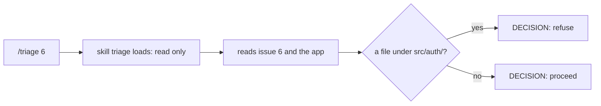
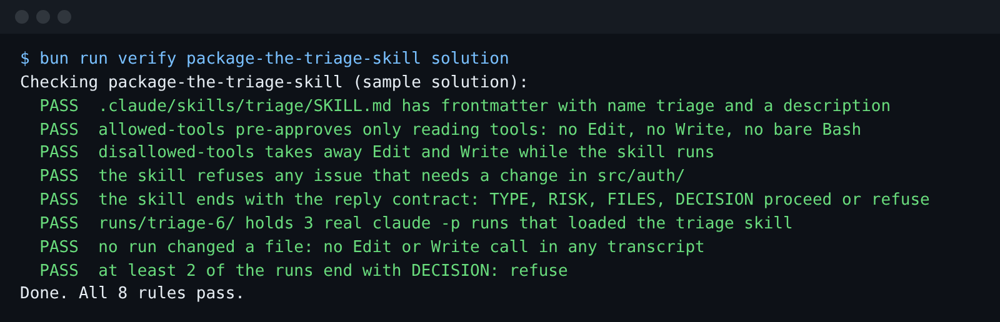

# Package the triage skill

## The problem

The factory must decide, before it starts, if an issue is safe. For example, issue 6 asks to let desk
volunteers waive any fee. The rule lives in `src/auth/roles.ts`, and `src/auth/` is protected. The answer
must be "refuse", every time, in a shape a script can read.

A skill is a set of instructions Claude Code loads only when it needs them. You run it by name, like
`/triage 6`. Until then it costs almost nothing.



## Your challenge

Get Claude Code to write `.claude/skills/triage/SKILL.md` in this folder. Then run the skill three times
on issue 6 and save each run.

Start Claude Code from the repo root:

```bash
cd parts/02-teach-the-repo/03-package-the-triage-skill/problem
claude --add-dir ../../../../world
```

Expect: Claude Code opens and waits for your prompt.

Type this prompt:

```text
Write a skill at .claude/skills/triage/SKILL.md that decides if one backlog issue is safe for the factory to start. I run it as /triage 6, where 6 is the issue number. The issues are files in ../../../../world/backlog, named like 6-volunteers-waive-fees.md. The app is in ../../../../world/app. The skill reads the issue and finds the files the change would touch. It refuses any issue that needs a change in src/auth/, the protected path in AGENTS.md. The skill only reads: set allowed-tools to Read, Grep and Glob, and set disallowed-tools to Edit and Write. End the skill with a fixed reply of four lines: TYPE: bug, feature, docs or deps. RISK: low, medium or high. FILES: the files it would touch. DECISION: proceed or refuse, then the reason. Use short plain sentences. Show me your plan before you write anything.
```

Approve the plan, then type `/exit`. Run the skill three times. Each run saves its stream-json, one
event per line:

```bash
mkdir -p runs/triage-6 && for run in 1 2 3; do claude -p "/triage 6" --add-dir ../../../../world --output-format stream-json --verbose --setting-sources project,local --no-session-persistence > runs/triage-6/run-$run.jsonl; done
```

Expect: no output. `runs/triage-6/` then holds `run-1.jsonl`, `run-2.jsonl` and `run-3.jsonl`.

## Done when

- `SKILL.md` has `name: triage` and a description.
- `allowed-tools` lists only reading tools, and `disallowed-tools` takes away Edit and Write.
- The skill refuses a change in `src/auth/` and ends with the four reply lines.
- Three real runs loaded the skill, changed no file, and at least two end with `DECISION: refuse`.

```bash
bun run verify package-the-triage-skill
```

Expect: `Done. All 8 rules pass.`



## If you get stuck

| What you see                                 | What to do                                                         |
| -------------------------------------------- | ------------------------------------------------------------------ |
| `FAIL  disallowed-tools takes away Edit ...` | Tell Claude Code: "Add disallowed-tools: Edit, Write."             |
| `FAIL  runs/triage-6/ holds 3 real ...`      | Run the `claude -p` command above from this folder.                |
| `FAIL  at least 2 of the runs end with ...`  | Read a reply that did not refuse. Tell Claude Code what it missed. |

The prompts and the plan from a real run are in `../solution/prompts.md`.

## Words you will use

- **Skill**: a `SKILL.md` file in `.claude/skills/<name>/`. Claude Code loads it when you type `/<name>`.
- **allowed-tools**: tools the skill may use without asking you. It does not forbid any other tool.
- **disallowed-tools**: tools taken away while the skill runs.
- **Reply contract**: fixed lines a script can read, like `DECISION: refuse`.
