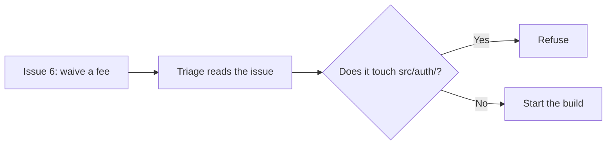

# Teach the repo

Claude misses one money rule in this repo. You will fix it. Then you will teach the factory to refuse a risky issue.

## What you leave with

- A short instructions file, `AGENTS.md`.
- A money rule that loads only for money code.
- A triage skill. It reads an issue and says if it is safe to start.

## Words to know

- **Factory**: the system that takes an issue and builds it with Claude Code.
- **Issue**: a request for a change. Each one is a file in `world/backlog/`.
- **Triage**: the first check. It asks: is this issue safe to start?
- **Check**: a script that tests your work and prints each rule.
- **Protected folder**: a folder no change may touch without a person.

## The story

Claude Code reads `AGENTS.md` at the start of each session. Ours is long. Claude skips the parts it does not reach.

Money in `src/fees/` is stored in whole cents. £33.33 is stored as 3333. Claude missed this rule when it changed `splitCharge` in `src/fees/split.ts`.

Then comes issue 6. Desk volunteers want to waive any fee. To waive a fee means to cancel it. The rule that decides this lives in `src/auth/roles.ts`. That folder is protected. So the factory must refuse issue 6.

## The picture

Triage reads the issue and answers one question.



## Your three steps

Do the steps in order. In each step, ask Claude Code for the change, read its plan, approve it, then run the check.

### 1. Shorten the instructions file

Step name: `trim-the-agents-file`. Keep only what Claude cannot find in the repo. Keep the protected folders and the gate command, `bun run gate`.

### 2. Add the money rule

Step name: `add-a-path-rule`. Add `.claude/rules/money.md`. It loads only when Claude reads a file under `src/fees/`. It says money is kept in whole cents.

### 3. Add the triage skill

Step name: `package-the-triage-skill`. Add `.claude/skills/triage/SKILL.md`. The skill only reads files. It ends with a fixed reply that a script can read.

## Check each step

You can ask Claude Code to run a check. Type:

```text
Run this command and tell me what it printed. Do not change anything to make it pass.
```

Or run the checks yourself from the top folder of the repo:

```bash
bun run verify trim-the-agents-file
```

Expect: `Done. All 9 rules pass.`

```bash
bun run verify add-a-path-rule
```

Expect: `Done. All 6 rules pass.`

```bash
bun run verify package-the-triage-skill
```

Expect: `Done. All 8 rules pass.`

```bash
bun run verify part teach-the-repo
```

Expect: `Part teach-the-repo is done: 3/3 steps pass.`

To see a passing answer at any time, check the sample solution:

```bash
bun run verify package-the-triage-skill solution
```

Expect: `Done. All 8 rules pass.`

## If you get stuck

- **A rule is in two files.** Keep each rule in one file.
- **The folder tree is still in the file.** Remove it. It goes out of date.
- **A protected folder is missing.** Put it back.
- **The triage skill can edit files.** Allow it only the tools it needs.

## Your assignment

**The problem:** the instructions file is long, and Claude still misses the money rule.

**What you hand in:** one commit in your own copy of the course. It holds:

- `AGENTS.md`, under 80 lines.
- `CLAUDE.md`, which loads `AGENTS.md`.
- `.claude/rules/money.md`.
- `.claude/skills/triage/SKILL.md`.
- Three saved runs in `runs/triage-6/`.

**How it is checked.** Answer each question yes or no:

1. Does `bun run verify trim-the-agents-file` pass?
2. Does `bun run verify add-a-path-rule` pass?
3. Does `bun run verify package-the-triage-skill` pass, with at least 2 of the 3 runs refusing issue 6?
4. Does `AGENTS.md` still name `src/auth/` and `bun run gate`?

**Extra:** open `claude` in the starting folder of `trim-the-agents-file`. Type `/context`. It shows how many tokens the memory files use. Do the same in your trimmed copy, and write both numbers in your commit message.

## Finished

Your factory now has its instructions in three layers. `AGENTS.md` loads every session. The money rule loads only for `src/fees/`. The triage skill refuses issue 6.

Next, in the "Split the roles" part, you split the work between three agents.
