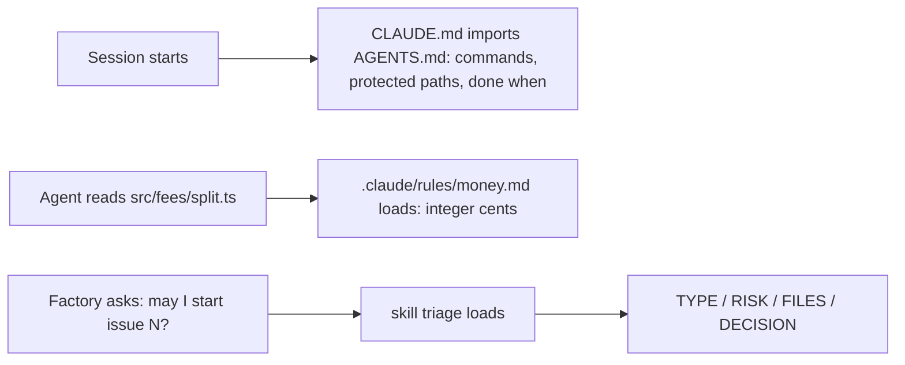

# Teach the repo

Moves the **Outcome**: the factory's instructions, short enough to load every time and exact where they matter.

Answers the question: **what is it allowed to touch, and what must it know?**

## The problem

Claude Code reads an instructions file at the start of every session. In the library's repo, that file is
`AGENTS.md`. `CLAUDE.md` imports it, which means it pulls in the text of `AGENTS.md`.

The library's file grew with every surprise. Now it has three faults.

1. It repeats the folder tree. Claude Code can read the folders itself.
2. It costs tokens on every turn. A token is a small piece of text, and you pay for each one.
3. It still gets ignored at the one place it matters.

For example, money in `src/fees/` is kept in integer cents. That means whole numbers of cents: £33.33 is
stored as 3333. The function `splitCharge` in `src/fees/split.ts` works this way. Yet Claude Code can still miss
this rule when it changes that file.

The factory also has no fixed way to decide if an issue is safe to start. For example, issue 6 asks to let
desk volunteers waive any fee. Its rule lives in `src/auth/roles.ts`, and `src/auth/` is a protected path.
The factory should refuse that issue, every time.

In this part you ask Claude Code to fix all three faults. You read its plan, approve it, and run the check.

- A **path rule** is a short instructions file that loads only when Claude Code reads a matching file.
- A **skill** is a set of instructions that Claude Code loads only when it needs them.
- **Triage** means deciding if an issue is ready to start, and if it is safe.

## Why it matters

Anthropic's own guidance says a long instructions file costs you on every turn. It says: "Aim to keep
CLAUDE.md under 200 lines by including only essentials". It also says to move workflow steps into skills.
Skills "load on-demand only when invoked" (https://code.claude.com/docs/en/costs).

Anthropic's best-practice page lists one habit to stop. That habit is: "Describe your architecture and file
layout in `CLAUDE.md`". The page gives the reason: "Claude reads the repo itself. Only write down what isn't in
there." (https://code.claude.com/docs/en/best-practices).



| Step                       | Minutes | What you produce                                               | What its check reads                                                                                                                                                                  |
| -------------------------- | ------- | -------------------------------------------------------------- | ------------------------------------------------------------------------------------------------------------------------------------------------------------------------------------- |
| `trim-the-agents-file`     | 15      | `AGENTS.md` under 80 lines and a `CLAUDE.md` that imports it   | headings Commands, Protected paths, Done when; `bun run gate` named; no line that only says where a folder is; `@AGENTS.md` in CLAUDE.md                                              |
| `add-a-path-rule`          | 10      | `.claude/rules/money.md` with `paths` frontmatter              | the globs match `src/fees/split.ts` and no app file outside `src/fees/` and `tests/fees/`; the body says integer cents and names the test                                             |
| `package-the-triage-skill` | 20      | `.claude/skills/triage/SKILL.md` and three runs of `/triage 6` | the frontmatter (`allowed-tools` reads only, `disallowed-tools` Edit and Write); the reply contract; the three stream-json runs: the skill loaded, no file changed, at least 2 refuse |

Claude Code writes every file in this table. You tell it what you want in plain words, read its plan, and
approve it. Each step's `problem/` folder is where you start `claude`. Each step's `solution/prompts.md` shows
the prompts, the plan and the reply from a real run.

## Walkthrough

Do each step's challenge in its `problem/` folder first. Then run its check from the repo root.

```bash
bun run verify trim-the-agents-file
```

Expect: `Done. All 8 rules pass.`

```bash
bun run verify add-a-path-rule
```

Expect: `Done. All 6 rules pass.`

```bash
bun run verify package-the-triage-skill
```

Expect: `Done. All 8 rules pass.`

```bash
bun run verify part teach-the-repo
```

Expect: `Part teach-the-repo is done: 3/3 steps pass.`

To see a passing answer at any time, check the sample solution. For example:

```bash
bun run verify package-the-triage-skill solution
```

Expect: `Done. All 8 rules pass.`

## Assignment

**The problem:** the agents file is long, and it is still ignored where money is handled.

**What you hand in:** one commit on your own copy of the course. It holds `AGENTS.md` under 80 lines and
`CLAUDE.md` that imports it. It also holds `.claude/rules/money.md`, `.claude/skills/triage/SKILL.md` and
the three runs in `runs/triage-6/`.

**How it is checked:** each line is yes or no.

1. Does `bun run verify trim-the-agents-file` pass?
2. Does `bun run verify add-a-path-rule` pass?
3. Does `bun run verify package-the-triage-skill` pass, with at least 2 of 3 runs refusing issue 6?
4. Does `AGENTS.md` still name `src/auth/` and `bun run gate`?

**Extension:** open `claude` in the starter folder of `trim-the-agents-file` and type `/context`. Note the
tokens for memory files. Do the same in your trimmed folder. Write both numbers in your commit message.

## Finished

You now have the factory's instructions in three layers. `AGENTS.md` loads every session and holds only
what Claude Code cannot read for itself. The money rule loads only when Claude Code touches `src/fees/`.
The triage skill loads only when the factory asks "may I start this issue?", and it refuses issue 6 every
time.

Next, in the "Split the roles" part, you split the work between three agents: a planner that only reads, a builder in its own
worktree, and a reviewer that must show the input that breaks the code.
