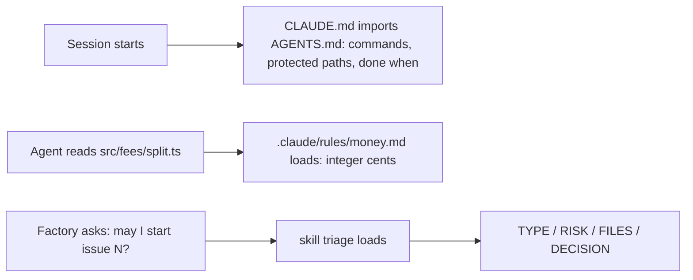

# Part 2: Teach the repo

Answers the question: **what is it allowed to touch, and what must it know?**

## The problem

The library's agent instructions file grew with every surprise. It restates the folder tree, costs tokens on
every turn, and is still ignored at the one place it matters: money is kept in integer cents in
`src/fees/`. And the factory has no fixed way to decide whether an issue is safe to start at all.

## Why it matters

Anthropic's own guidance says a long instructions file costs on every turn: "Aim to keep CLAUDE.md under
200 lines by including only essentials", and move workflow instructions into skills, which "load on-demand
only when invoked" (https://code.claude.com/docs/en/costs). Its best-practice page lists "Describe your
architecture and file layout in `CLAUDE.md`" as advice to stop following: "Claude reads the repo itself. Only
write down what isn't in there." (https://code.claude.com/docs/en/best-practices).



| Step | Minutes | What you produce | What its check reads |
|---|---|---|---|
| `trim-the-agents-file` | 15 | `AGENTS.md` under 80 lines and a `CLAUDE.md` that imports it | headings Commands, Protected paths, Done when; `bun run gate` named; no line that only restates a folder; `@AGENTS.md` in CLAUDE.md |
| `add-a-path-rule` | 10 | `.claude/rules/money.md` with `paths` frontmatter | frontmatter parses; the glob matches `src/fees/split.ts` and not `src/items/borrow.ts`; body says integer cents and names the test file |
| `package-the-triage-skill` | 20 | `.claude/skills/triage/SKILL.md` | a skill that loads (name, description, `allowed-tools` with no Edit or Write); the reply contract; three recorded `claude -p` runs of the skill on issue 6 (`world/recordings/`, see `RECORD.md`) end with `DECISION: refuse` in at least 2 in 2 of 3 runs |

## Walkthrough

TODO(part session): write each step's walkthrough and replace these Expect lines with real output.

```bash
bun run verify trim-the-agents-file
```

Expect: TODO(part session)

```bash
bun run verify add-a-path-rule
```

Expect: TODO(part session)

```bash
bun run verify package-the-triage-skill
```

Expect: TODO(part session)
