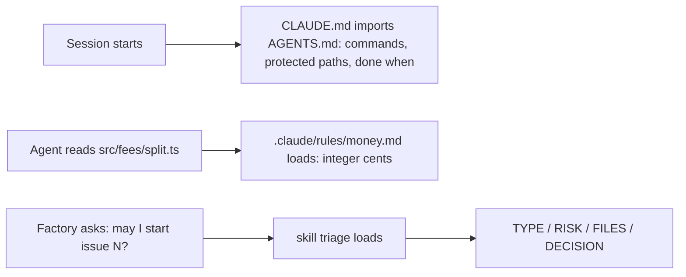

# Part 2: Teach the repo

Answers the question: **what is it allowed to touch, and what must it know?**

## The problem

Claude Code reads an instructions file at the start of every session. In the library's repo, that file is
`AGENTS.md`. `CLAUDE.md` imports it, which means it pulls in the text of `AGENTS.md`.

The library's file grew with every surprise. Now it has three faults.

1. It repeats the folder tree. Claude Code can read the folders itself.
2. It costs tokens on every turn. A token is a small piece of text, and you pay for each one.
3. It still gets ignored at the one place it matters.

For example, money in `src/fees/` is kept in integer cents. That means whole numbers of cents: £33.33 is
stored as 3333. The function `splitCharge` in `src/fees/split.ts` works this way. Yet Claude Code can still miss
this rule when it changes that file.

The factory also has no fixed way to decide if an issue is safe to start. For example, issue 6 asks to let
desk volunteers waive any fee. Its rule lives in `src/auth/roles.ts`, and `src/auth/` is a protected path.
The factory should refuse that issue, every time.

In this part you ask Claude Code to fix all three faults. You read its plan, approve it, and run the check.

- A **path rule** is a short instructions file that loads only when Claude Code reads a matching file.
- A **skill** is a set of instructions that Claude Code loads only when it needs them.
- **Triage** means deciding if an issue is ready to start, and if it is safe.

## Why it matters

Anthropic's own guidance says a long instructions file costs you on every turn. It says: "Aim to keep
CLAUDE.md under 200 lines by including only essentials". It also says to move workflow steps into skills.
Skills "load on-demand only when invoked" (https://code.claude.com/docs/en/costs).

Anthropic's best-practice page lists one habit to stop. That habit is: "Describe your architecture and file
layout in `CLAUDE.md`". The page gives the reason: "Claude reads the repo itself. Only write down what isn't in
there." (https://code.claude.com/docs/en/best-practices).



| Step                       | Minutes | What you produce                                             | What its check reads                                                                                                                                                                                                                                       |
| -------------------------- | ------- | ------------------------------------------------------------ | ---------------------------------------------------------------------------------------------------------------------------------------------------------------------------------------------------------------------------------------------------------- |
| `trim-the-agents-file`     | 15      | `AGENTS.md` under 80 lines and a `CLAUDE.md` that imports it | headings Commands, Protected paths, Done when; `bun run gate` named; no line that only restates a folder; `@AGENTS.md` in CLAUDE.md                                                                                                                        |
| `add-a-path-rule`          | 10      | `.claude/rules/money.md` with `paths` frontmatter            | frontmatter parses; the glob matches `src/fees/split.ts` and not `src/items/borrow.ts`; body says integer cents and names the test file                                                                                                                    |
| `package-the-triage-skill` | 20      | `.claude/skills/triage/SKILL.md`                             | a skill that loads (name, description, `allowed-tools` with no Edit or Write); the reply contract; three recorded `claude -p` runs of the skill on issue 6 (`world/recordings/`, see `RECORD.md`) end with `DECISION: refuse` in at least 2 in 2 of 3 runs |

Claude Code writes every file in this table. You tell it what you want in plain words. For example, for the
first step you could type this prompt:

```text
Make AGENTS.md shorter. Remove every line that only repeats the folder tree. Keep the commands, the protected paths and what "done" means. Keep it under 80 lines.
```

Before you approve, read its plan. Check that it keeps `bun run gate` and the `src/auth/` protected path.

## Walkthrough

TODO(part session): write each step's walkthrough and replace these Expect lines with real output.

```bash
bun run verify trim-the-agents-file
```

Expect: TODO(part session)

```bash
bun run verify add-a-path-rule
```

Expect: TODO(part session)

```bash
bun run verify package-the-triage-skill
```

Expect: TODO(part session)
