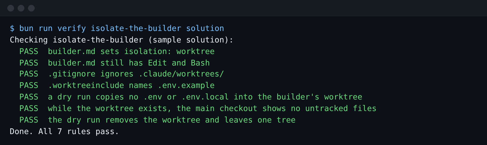

# Isolate the builder

## The problem

The builder edits files. If it works in your own checkout, a half-done change sits next to your work. Two
builders on two issues would edit the same files at once.

A worktree fixes this. It is a second copy of the repo, on its own branch, in its own folder. Claude Code
can give a subagent one of its own with `isolation: worktree`. It makes the copy under `.claude/worktrees/`.

A new worktree has only the files git tracks. A `.worktreeinclude` file names ignored files to copy in.
The docs' own example copies `.env`. For example, the library's `.env` would hold `DESK_SMS_TOKEN`, the key
that texts members. A builder that runs with nobody watching must never get it.

```mermaid
flowchart LR
  M[your checkout, with .env] -- git worktree add --> W[.claude/worktrees/builder]
  M -. .worktreeinclude: .env.example only .-> W
  W --> B[builder edits here] --> R[worktree removed]
```

## Your challenge

Get Claude Code to put the builder in its own worktree and keep secrets out of it.

Start Claude Code in this folder:

```bash
claude --add-dir ../../../../world
```

Expect: Claude Code opens and waits for your prompt.

Type this prompt:

```text
Make the builder work in its own git worktree, so its edits never touch this checkout. Set isolation: worktree in .claude/agents/builder.md. Add .claude/worktrees/ to a .gitignore in this folder, so the worktree does not show up as untracked files. Write a .worktreeinclude that copies only .env.example into a new worktree, never .env or .env.local: the builder runs with nobody watching, and it must not get our secrets. Show me your plan before you change anything.
```

Read the plan. Check that no line in `.worktreeinclude` matches `.env`. Then tell it to go ahead.

## Done when

- `builder.md` sets `isolation: worktree` and still has Edit and Bash.
- `.gitignore` ignores `.claude/worktrees/`.
- `.worktreeinclude` names `.env.example`.
- A dry run copies no `.env` or `.env.local` into the worktree.
- While the worktree exists, your checkout shows no untracked files, and the worktree is then removed.

The check makes the dry run with real git, in a copy of this folder. It never touches your checkout.

```bash
bun run verify isolate-the-builder
```

Expect: `Done. All 7 rules pass.`



## If you get stuck

| What you see                                | What to tell Claude Code                                   |
| ------------------------------------------- | ---------------------------------------------------------- |
| `FAIL  builder.md sets isolation: worktree` | "Add isolation: worktree to builder.md."                   |
| `FAIL  a dry run copies no .env ...`        | "Remove every line in .worktreeinclude that matches .env." |
| `FAIL  while the worktree exists, ...`      | "Add .claude/worktrees/ to .gitignore in this folder."     |

The prompts and the plan from a real run are in `../solution/prompts.md`.

## Words you will use

- **Worktree**: a second working copy of one repo, on its own branch, in its own folder.
- **isolation: worktree**: subagent frontmatter that gives the subagent its own worktree.
- **.worktreeinclude**: a list of ignored files to copy into each new worktree. It uses `.gitignore` patterns.
- **Secret**: a value that grants access, like a token. It lives in `.env`, which git ignores.
