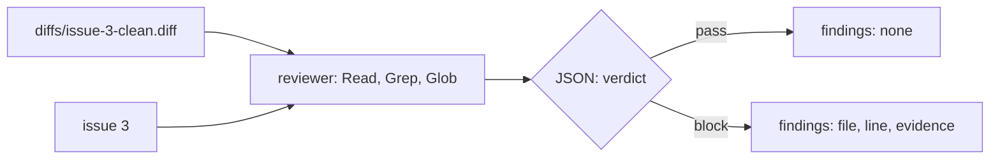

# Build the reviewer

## The problem

The builder's own tests pass. That proves only what the builder thought to test. Anthropic's harness
research found that agents "reliably skew positive when grading their own work"
(https://www.anthropic.com/engineering/harness-design-long-running-apps).

So the factory needs a reviewer: a third agent that reads the change with fresh eyes and changes nothing.
For example, `diffs/issue-3-clean.diff` in this folder is a correct fix for issue 3. A good reviewer
passes it. It may block a change only with evidence: the exact input that breaks the code.



## Your challenge

Get Claude Code to write `.claude/agents/reviewer.md` in this folder. Then run it three times on the clean
fix.

Start Claude Code from the repo root:

```bash
cd parts/03-split-the-roles/03-build-the-reviewer/problem
claude --add-dir ../../../../world
```

Expect: Claude Code opens and waits for your prompt.

Type this prompt:

```text
Make a third subagent, .claude/agents/reviewer.md. It reviews one change with fresh eyes and changes nothing. Its tools are Read, Grep and Glob only, with model: sonnet. I give it a diff file, such as diffs/issue-3-clean.diff, and the issue number. The app the diff changes is in ../../../../world/app, and the issues are in ../../../../world/backlog. It checks that the change does what the issue asks. It skips style. It may only block with evidence: the exact input that breaks the code, and what the code returns for it. It replies with JSON only, in this shape: {"verdict": "pass" or "block", "findings": [{"file": ..., "line": ..., "evidence": ...}]}. The line is a line number in the changed file. Use short plain sentences. Show me your plan before you write anything.
```

Read the plan, approve it, then type `/exit`. Run the reviewer three times on the clean fix:

```bash
mkdir -p runs/review-clean && for run in 1 2 3; do claude -p "Review the change in diffs/issue-3-clean.diff for issue 3." --agent reviewer --add-dir ../../../../world --output-format stream-json --verbose --setting-sources project,local --no-session-persistence > runs/review-clean/run-$run.jsonl; done
```

Expect: no output. `runs/review-clean/` then holds three `.jsonl` files.

## Done when

- `reviewer.md` lists only reading tools and sets a `model`.
- Its prompt sets the JSON reply, skips style, and blocks only with evidence.
- Three real runs ran as the reviewer.
- At least two reply with `"verdict": "pass"`.

```bash
bun run verify build-the-reviewer
```

Expect: `Done. All 7 rules pass.`

## If you get stuck

| What you see                                | What to do                                                       |
| ------------------------------------------- | ---------------------------------------------------------------- |
| `FAIL  reviewer.md lists its tools ...`     | Tell Claude Code: "Set tools: Read, Grep, Glob in reviewer.md."  |
| `FAIL  the prompt allows a block only ...`  | Tell Claude Code: "Block only with the input that breaks it."    |
| `FAIL  at least 2 runs reply with JSON ...` | Read a run that blocked. Tell Claude Code a guess is no finding. |

The prompts and the plan from a real run are in `../solution/prompts.md`.

## Words you will use

- **Reviewer**: an agent that judges a change it did not write. It reads only.
- **Diff**: the lines a change adds and removes, as `git diff` prints them.
- **Verdict**: the reviewer's answer, `pass` or `block`.
- **Evidence**: the exact input that breaks the code, and what the code returns for it.
