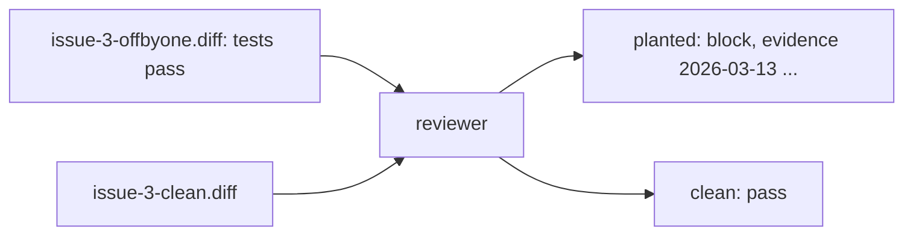
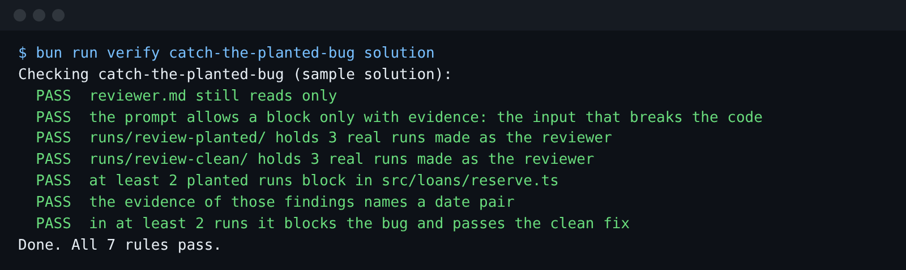

# Catch the planted bug

## The problem

`diffs/issue-3-offbyone.diff` in this folder looks like a good fix for issue 3. Its two new tests pass, so
the gate is green. A builder that grades itself would ship it.

It is still wrong. The fix changed `overlaps` on one side only. For example, an existing booking from
2026-03-13 to 2026-03-15 and a new one from 2026-03-10 to 2026-03-13 share the 13th. The planted code says
they do not clash. Two people turn up for one drill again.



## Your challenge

Run your reviewer three times on each diff. It must block the planted bug with a date pair as evidence,
and pass the clean fix in the same runs. If it misses, tell Claude Code what to change in `reviewer.md`.

Run each pair of reviews from this folder:

```bash
mkdir -p runs/review-planted runs/review-clean && for run in 1 2 3; do for diff in planted clean; do file=issue-3-clean.diff; [ $diff = planted ] && file=issue-3-offbyone.diff; claude -p "Review the change in diffs/$file for issue 3." --agent reviewer --add-dir ../../../../world --output-format stream-json --verbose --setting-sources project,local --no-session-persistence > runs/review-$diff/run-$run.jsonl; done; done
```

Expect: no output. Each `runs/` folder then holds three `.jsonl` files.

Read one block. Is the evidence an input you could type into a test? If not, open `claude` here and ask
for a reviewer that names the two date ranges that break the code. Then run the reviews again.

## Done when

- `reviewer.md` reads only, and blocks only with evidence.
- Three real runs on each diff ran as the reviewer.
- In at least two runs, it blocks the planted diff in `src/loans/reserve.ts` with a date pair.
- In those same runs, it passes the clean fix.

```bash
bun run verify catch-the-planted-bug
```

Expect: `Done. All 7 rules pass.`



## If you get stuck

| What you see                                     | What to do                                                        |
| ------------------------------------------------ | ----------------------------------------------------------------- |
| `FAIL  at least 2 planted runs block ...`        | Tell Claude Code: "Try each date range in both orders."           |
| `FAIL  the evidence of those findings ...`       | Tell Claude Code: "Give the two date ranges that break the code." |
| `FAIL  in at least 2 runs it blocks the bug ...` | Read the clean run that blocked. A doubt is not a finding.        |

Six real reviews and a weak reviewer that missed the bug are in `../solution/prompts.md`.

## Words you will use

- **Planted bug**: a mistake put in on purpose, to test the reviewer.
- **Off by one**: code that is wrong by exactly one, here one day, at the edge.
- **Date pair**: two date ranges that show the bug, such as 2026-03-13 to 2026-03-15 and 2026-03-10 to
  2026-03-13.
- **Run pair**: run 1 on the planted diff and run 1 on the clean diff, judged together.
