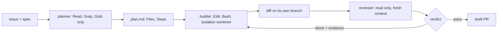

# Part 3: Split the roles

Answers the question: **can it check its own work?**

## The problem

The builder is the agent that writes the code. If the builder also grades its own work, it passes its own
bugs.

For example, look at issue 3. The cordless drill (drill-01) is out on loan L-101, due back on the 13th. The
reservation screen let someone book it from the 13th. Two people turned up for one drill.

A fix for this can still be off by one at the due date. Off by one means the code is wrong by exactly one day,
at the edge. The builder tests dates that are far apart, so its own tests pass. The bug stays hidden.

So the library needs three agents, each with one job.

- The **planner** only reads the code. It writes a plan and changes nothing.
- The **builder** works in its own worktree. A worktree is a second copy of the repo, on its own branch.
- The **reviewer** reads the change with fresh eyes. To block it, the reviewer must show the input that
  breaks the code.

You ask Claude Code to make each agent. You read its plan, approve it, and run the check.

## Why it matters

A harness is the program that runs the agents and passes work between them. Anthropic's harness research
found that "agents reliably skew positive when grading their own work". In plain words, agents grade their
own work too kindly. The research names the fix.

"Separating the agent doing the work from the agent judging it proves to be a strong lever to address this
issue."

The split costs money. The full harness cost about 20 times as much as a solo run. That was $200 against $9
(https://www.anthropic.com/engineering/harness-design-long-running-apps).



| Step                        | Minutes | What you produce                                         | What its check reads                                                                                                                                                                      |
| --------------------------- | ------- | -------------------------------------------------------- | ----------------------------------------------------------------------------------------------------------------------------------------------------------------------------------------- |
| `split-planner-and-builder` | 20      | `.claude/agents/planner.md` and `builder.md`             | planner `tools` has no Edit, Write or Bash and sets `model`; builder has Edit and Bash; a recorded `claude -p` run of the planner on issue 3 (its `plan.md`) names `src/loans/reserve.ts` |
| `isolate-the-builder`       | 10      | `isolation: worktree` on the builder, `.worktreeinclude` | the frontmatter; `.worktreeinclude` lists `.env.example` and never `.env`; a dry run creates and removes a worktree                                                                       |
| `build-the-reviewer`        | 20      | `.claude/agents/reviewer.md`                             | read-only tools; the JSON reply contract (`verdict`, `findings[]` with `file`, `line`, `evidence`); three recorded `claude -p` runs of the reviewer pass the clean diff                   |
| `catch-the-planted-bug`     | 15      | a review of the planted off-by-one diff for issue 3      | in 2 of 3 runs `block` with a finding in `src/loans/reserve.ts` whose evidence names a date pair, and `pass` on the clean diff in the same runs                                           |

A good review names a real input. For example, a finding on issue 3 points at `src/loans/reserve.ts`. Its
evidence is a date pair: a loan due on the 13th and a booking that starts on the 13th. The reviewer's reply
is JSON with a `verdict` of `pass` or `block`.

## Walkthrough

TODO(part session): write each step's walkthrough and replace these Expect lines with real output.

```bash
bun run verify split-planner-and-builder
```

Expect: TODO(part session)

```bash
bun run verify isolate-the-builder
```

Expect: TODO(part session)

```bash
bun run verify build-the-reviewer
```

Expect: TODO(part session)

```bash
bun run verify catch-the-planted-bug
```

Expect: TODO(part session)
