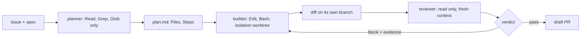

# Part 3: Split the roles

Moves the **Outcome**: the planner, the builder in its own worktree, and a reviewer that must show evidence.

Answers the question: **can it check its own work?**

## The problem

The builder is the agent that writes the code. If the builder also grades its own work, it passes its own
bugs.

For example, look at issue 3. The cordless drill (drill-01) is out on loan L-101, due back on the 13th. The
reservation screen let someone book it from the 13th. Two people turned up for one drill.

A fix for this can still be off by one at the due date. Off by one means the code is wrong by exactly one day,
at the edge. The builder tests dates that are far apart, so its own tests pass. The bug stays hidden.

So the library needs three agents, each with one job.

- The **planner** only reads the code. It writes a plan and changes nothing.
- The **builder** works in its own worktree. A worktree is a second copy of the repo, on its own branch.
- The **reviewer** reads the change with fresh eyes. To block it, the reviewer must show the input that
  breaks the code.

You ask Claude Code to make each agent. You read its plan, approve it, and run the check.

## Why it matters

A harness is the program that runs the agents and passes work between them. Anthropic's harness research
found that "agents reliably skew positive when grading their own work". In plain words, agents grade their
own work too kindly. The research names the fix.

"Separating the agent doing the work from the agent judging it proves to be a strong lever to address this
issue."

The split costs money. The full harness cost about 20 times as much as a solo run. That was $200 against $9
(https://www.anthropic.com/engineering/harness-design-long-running-apps).



| Step                        | Minutes | What you produce                                              | What its check reads                                                                                                                                                                                   |
| --------------------------- | ------- | ------------------------------------------------------------- | ------------------------------------------------------------------------------------------------------------------------------------------------------------------------------------------------------ |
| `split-planner-and-builder` | 20      | `.claude/agents/planner.md`, `builder.md`, three planner runs | planner tools read only and a `model`; builder has Edit and Bash; three `claude -p --agent planner` runs on issue 3: run as the planner, no edits, the plan names `src/loans/reserve.ts` in at least 2 |
| `isolate-the-builder`       | 10      | `isolation: worktree`, `.gitignore`, `.worktreeinclude`       | the frontmatter; `.claude/worktrees/` ignored; a real git dry run: no `.env` copied into the worktree, the checkout stays clean, the worktree is removed                                               |
| `build-the-reviewer`        | 20      | `.claude/agents/reviewer.md`, three reviews of the clean fix  | read-only tools; the JSON reply contract; skip style; block only with evidence; three real runs, at least 2 pass the clean diff                                                                        |
| `catch-the-planted-bug`     | 15      | three reviews of each diff in `diffs/`                        | in at least 2 run pairs: `block` on the planted diff in `src/loans/reserve.ts` with a date pair as evidence, and `pass` on the clean diff                                                              |

A good review names a real input. For example, the reviewer's finding on the planted diff points at
`src/loans/reserve.ts`. Its evidence is a date pair: a booking from 2026-03-13 to 2026-03-15 and one from
2026-03-01 to 2026-03-13. The planted code says they do not clash.

Claude Code writes every agent file. You type the prompt, read the plan, approve it, then record the runs
with `claude -p`. Each step's `solution/prompts.md` shows the prompts, the plan and the replies from real
runs.

## Walkthrough

Do each step's challenge in its `problem/` folder first. Then run its check from the repo root.

```bash
bun run verify split-planner-and-builder
```

Expect: `Done. All 8 rules pass.`

```bash
bun run verify isolate-the-builder
```

Expect: `Done. All 7 rules pass.`

```bash
bun run verify build-the-reviewer
```

Expect: `Done. All 7 rules pass.`

```bash
bun run verify catch-the-planted-bug
```

Expect: `Done. All 7 rules pass.`

```bash
bun run verify part split-the-roles
```

Expect: `Part split-the-roles is done: 4/4 steps pass.`

To see a passing answer at any time, check the sample solution. For example:

```bash
bun run verify catch-the-planted-bug solution
```

Expect: `Done. All 7 rules pass.`

## Assignment

**The problem:** a builder that grades its own work passes its own bug.

**What you hand in:** one commit on your own copy of the course. It holds `planner.md`, `builder.md` and
`reviewer.md`. It also holds the recorded runs: the planner on issue 3, and the reviewer on both diffs.

**How it is checked:** each line is yes or no.

1. Does `bun run verify split-planner-and-builder` pass?
2. Does `bun run verify isolate-the-builder` pass?
3. Does `bun run verify build-the-reviewer` pass?
4. Does `bun run verify catch-the-planted-bug` pass: block on the bug with a date pair, pass on the clean
   diff, in 2 of 3 runs?

**Extension:** record 20 reviews, 10 on each diff. Count how often the reviewer blocks the bug and how
often it passes the clean fix. Change the prompt once, record 20 more, and compare the two counts.

## Finished

You now have three agents with one job each. The planner reads and plans. The builder edits, in its own
worktree, with no secrets. The reviewer reads the change with fresh eyes and blocks only with an input that
breaks the code. It caught the planted off-by-one that the builder's own tests passed.

Next, in Part 4, you build the walls the agents cannot get around: deny rules, a hook that locks the
tests, a Stop hook that demands a fresh gate, and a required check on the main branch.
