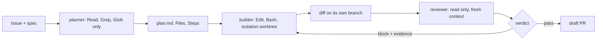

# Part 3: Split the roles

Answers the question: **can it check its own work?**

## The problem

A builder that writes the code and then grades it passes its own bugs. Issue 3 is the proof: a fix for the
double booking can still be off by one at the due date, and the builder's own tests, with dates far apart,
pass. The library needs a planner that only reads, a builder that works in its own copy, and a reviewer that
must show the input that breaks the code.

## Why it matters

Anthropic's harness research found that "agents reliably skew positive when grading their own work", and that
"Separating the agent doing the work from the agent judging it proves to be a strong lever to address this
issue." The separation costs money: the full harness ran at about 20 times the cost of a solo run, $200
against $9 (https://www.anthropic.com/engineering/harness-design-long-running-apps).



| Step | Minutes | What you produce | What its check reads |
|---|---|---|---|
| `split-planner-and-builder` | 20 | `.claude/agents/planner.md` and `builder.md` | planner `tools` has no Edit, Write or Bash and sets `model`; builder has Edit and Bash; a recorded `claude -p` run of the planner on issue 3 (its `plan.md`) names `src/loans/reserve.ts` |
| `isolate-the-builder` | 10 | `isolation: worktree` on the builder, `.worktreeinclude` | the frontmatter; `.worktreeinclude` lists `.env.example` and never `.env`; a dry run creates and removes a worktree |
| `build-the-reviewer` | 20 | `.claude/agents/reviewer.md` | read-only tools; the JSON reply contract (`verdict`, `findings[]` with `file`, `line`, `evidence`); three recorded `claude -p` runs of the reviewer pass the clean diff |
| `catch-the-planted-bug` | 15 | a review of the planted off-by-one diff for issue 3 | in 2 of 3 runs `block` with a finding in `src/loans/reserve.ts` whose evidence names a date pair, and `pass` on the clean diff in the same runs |

## Walkthrough

TODO(part session): write each step's walkthrough and replace these Expect lines with real output.

```bash
bun run verify split-planner-and-builder
```

Expect: TODO(part session)

```bash
bun run verify isolate-the-builder
```

Expect: TODO(part session)

```bash
bun run verify build-the-reviewer
```

Expect: TODO(part session)

```bash
bun run verify catch-the-planted-bug
```

Expect: TODO(part session)
