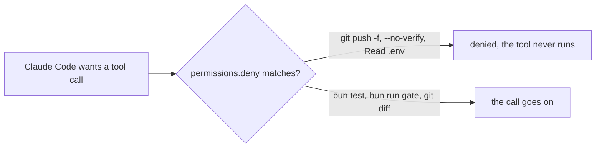

# Deny the shortcuts

## The problem

`CLAUDE.md` in this folder asks Claude Code never to force push, never to skip git hooks, and never to read
`.env`. A request is followed nearly every time. A factory runs hundreds of times.

For example, when the gate fails, `git commit --no-verify` skips the checks and the work looks
done. A deny rule stops that call before the tool runs, every time, whatever the prompt says.



## Your challenge

Get Claude Code to add `permissions.deny` to `.claude/settings.json` in this folder. Keep the allow list.

Start Claude Code from the repo root:

```bash
cd parts/04-gate-the-agent/01-deny-the-shortcuts/problem
claude --add-dir ../../../../world
```

Expect: Claude Code opens and waits for your prompt.

Type this prompt:

```text
CLAUDE.md asks you never to force push, never to skip git hooks with --no-verify, and never to read .env. A request can be missed, so make each one a deny rule in .claude/settings.json under permissions.deny. Deny a force push written both as --force and as -f. Deny --no-verify anywhere in a command, on git commit and on git push. Deny reading .env and every .env file, like .env.local. Keep the allow list as it is. Do not deny everyday work: bun test, bun run gate, git diff and a normal git commit must still work. Read the permission rule syntax in the Claude Code docs if you need to. Show me your plan before you change anything.
```

Read the plan. Check that `-f` after the branch name is caught too. Then tell it to go ahead. Claude Code asks
before it edits its own settings. Approve that edit.

Then do the [session moves](SESSION-MOVES.md).

## Done when

- `.claude/settings.json` has a `permissions.deny` list.
- `git push --force origin main` and `git push origin main -f` are denied.
- `--no-verify` is denied on `git commit` and on `git push`.
- Reading `.env` and `.env.local` is denied.
- `bun test`, `bun run gate`, `git diff`, a normal `git commit` and reading `src/` are not denied.
- Your saved session shows the session moves.

Ask Claude Code:

```text
Run `bun run verify deny-the-shortcuts` and tell me what it printed. Do not change anything to make it pass.
```

```bash
bun run verify deny-the-shortcuts
```

Expect: `Done. All 6 rules pass.`

## If you get stuck

| What you see                            | What to tell Claude Code                                    |
| --------------------------------------- | ----------------------------------------------------------- |
| `FAIL  a force push is denied ...`      | "Also deny -f after the remote and branch: git push * -f*." |
| `FAIL  --no-verify is denied ...`       | "Match --no-verify anywhere, with a * on each side."        |
| `FAIL  everyday work is not denied ...` | "Deny only the shortcuts, not every git push or commit."    |

The rule syntax is on https://code.claude.com/docs/en/permissions. The prompts and the plan from a real run are in
`../solution/prompts.md`.

## Words you will use

- **Deny rule**: a pattern like `Bash(git push * -f*)`. A matching call is refused before it runs.
- **Ask rule**: a pattern that makes Claude Code ask you first. In a run with nobody watching, it does not
  protect you.
- **`--no-verify`**: a git flag that skips the repo's git hooks, such as the one that runs the tests.
- **`.env`**: a file of secrets, such as the desk's SMS key. It must never reach a transcript.
