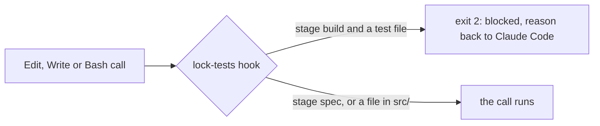
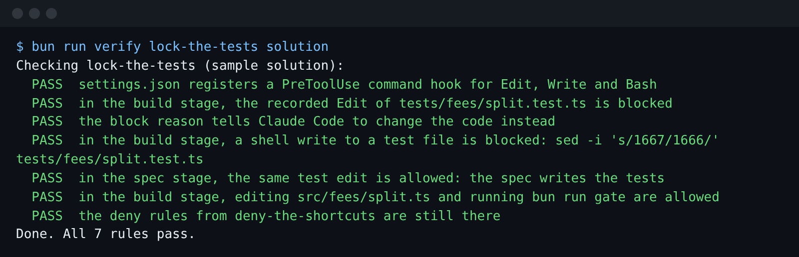

# Lock the tests

## The problem

Issue 2 says a damage charge of £33.33 split two ways loses a penny. The test `tests/fees/split.test.ts`
says what the fix must do. When it fails, an agent can fix `src/fees/split.ts` or
change the test.

For example, `sed -i 's/1667/1666/' tests/fees/split.test.ts` makes the test expect the wrong number. The
gate goes green.

A PreToolUse hook can. Claude Code runs it before every tool call and sends it the call as JSON.



## Your challenge

Get Claude Code to write `.claude/hooks/lock-tests.ts` and register it in `.claude/settings.json`. The
factory sets `FACTORY_STAGE` for each stage. Only the spec stage may write tests.

Start Claude Code from the repo root:

```bash
cd parts/04-gate-the-agent/02-lock-the-tests/problem
claude --add-dir ../../../../world
```

Expect: Claude Code opens and waits for your prompt.

Type this prompt:

```text
Write a PreToolUse hook at .claude/hooks/lock-tests.ts and register it in .claude/settings.json with the matcher Edit|Write|Bash, run with bun. When the FACTORY_STAGE environment variable is build, the hook blocks any change to a test file: an Edit or Write of a file under tests/ or named *.test.ts, and a Bash command that writes to one, like sed -i, a > redirect, mv, cp or rm. To block, it exits 2 and prints a reason on stderr that tells you to change the code under src/ and leave the test alone. In every other stage, and for every other file, it allows the call. Keep the deny list as it is. Claude Code sends the event as JSON on stdin; read the hooks guide in the Claude Code docs for its shape. Use whole-word names and short functions. Show me your plan before you write anything.
```

Read the plan. Check that it blocks with exit 2. Then tell it to go ahead, and approve the two
writes under `.claude/`.

## Done when

- `settings.json` registers a PreToolUse hook for Edit, Write and Bash.
- In the build stage, the hook blocks the recorded Edit of `tests/fees/split.test.ts` and the `sed -i` command.
- Its reason says to change `src/`.
- In the spec stage the same edit is allowed. In the build stage, editing `src/fees/split.ts` is allowed.
- The deny list from `deny-the-shortcuts` is still there.

Ask Claude Code:

```text
Run `bun run verify lock-the-tests` and tell me what it printed. Do not change anything to make it pass.
```

```bash
bun run verify lock-the-tests
```

Expect: `Done. All 7 rules pass.`



## If you get stuck

| What you see                                      | What to tell Claude Code                                   |
| ------------------------------------------------- | ---------------------------------------------------------- |
| `FAIL  in the build stage, the recorded Edit ...` | "Exit 2 to block. Exit 1 is only an error, the call runs." |
| `FAIL  ... a shell write to a test file ...`      | "Add Bash to the matcher and check its command."           |
| `FAIL  in the spec stage, the same test edit ...` | "Block only when FACTORY_STAGE is build."                  |

A real plan is in `../solution/prompts.md`.

## Words you will use

- **Hook**: a command Claude Code runs at a set moment, such as before each tool call.
- **PreToolUse**: the moment before a tool runs.
- **Exit 2**: the exit code that blocks the call. Claude Code reads stderr as the reason.
