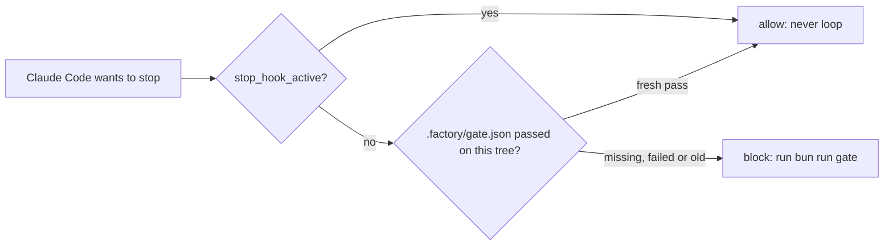

# Demand proof before stop

## The problem

The builder says "done" and stops. Did it run the gate? Did it run it on the code as it is now, or before
its last edit? For example, a builder runs `bun run gate`, sees it pass, then makes one more change to
`src/fees/split.ts`. The gate result is now stale, and the last change was never tested.

A Stop hook runs when Claude Code wants to stop. It can send Claude Code back to work with a reason.



## Your challenge

Get Claude Code to write `.claude/hooks/stop-gate.ts` and register it under `hooks.Stop`. In a factory
run, `bun run gate` writes `.factory/gate.json` with `exit_code` and `tree`. A new edit gives a
new tree.

Start Claude Code from the repo root:

```bash
cd parts/04-gate-the-agent/03-demand-proof-before-stop/problem
claude --add-dir ../../../../world
```

Expect: Claude Code opens and waits for your prompt.

Type this prompt:

```text
Write a Stop hook at .claude/hooks/stop-gate.ts and register it under hooks.Stop in .claude/settings.json, run with bun. In a factory run the app sits at the project root, and bun run gate writes .factory/gate.json with exit_code and tree, a hash of src/ and tests/. Read ../../../../world/gate.ts to see how it makes that hash. When FACTORY_STAGE is build, the hook must not let you stop until the gate passed on the code as it is now. Block the stop when gate.json is missing, when exit_code is not 0, or when its tree differs from a fresh hash of src/ and tests/. To block, print JSON with decision block and a reason that says what to do next. If stop_hook_active is true in the event, always allow the stop, so it can never loop. Find the project with CLAUDE_PROJECT_DIR. Keep the deny list and the lock-tests hook as they are. Use whole-word names and short functions. Show me your plan before you write anything.
```

Read the plan. Check that it hashes the same way as `world/gate.ts`. Then tell it to go ahead, and approve
the two writes under `.claude/`.

## Done when

- `settings.json` registers a Stop hook.
- In the build stage it blocks with a reason when the gate record is missing, failed, or for older code.
- It allows the stop on a fresh pass, and whenever `stop_hook_active` is true.
- Outside the build stage it allows the stop.

```bash
bun run verify demand-proof-before-stop
```

Expect: `Done. All 7 rules pass.`

## If you get stuck

| What you see                                     | What to tell Claude Code                           |
| ------------------------------------------------ | -------------------------------------------------- |
| `FAIL  ... with no gate record, the hook blocks` | "Print JSON with decision block and a reason."     |
| `FAIL  ... for an older version of the code ...` | "Compare the tree in gate.json with a fresh hash." |
| `FAIL  when stop_hook_active is true ...`        | "Allow the stop when stop_hook_active is true."    |

A real plan is in `../solution/prompts.md`.

## Words you will use

- **Stop hook**: a command Claude Code runs when it is about to stop.
- **Gate record**: `.factory/gate.json`, the result of the last `bun run gate`.
- **Tree hash**: a short code made from every file in `src/` and `tests/`. Any edit changes it.
- **stop_hook_active**: true when a Stop hook already sent Claude Code back once.
