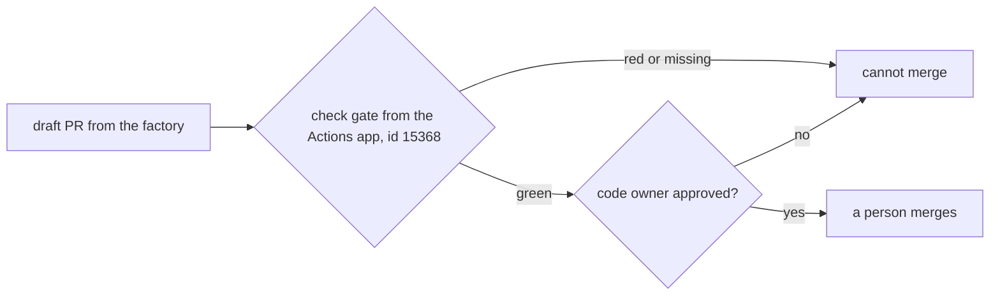

# Protect the main branch

## The problem

Hooks and deny rules are files in `.claude/`, which can change. The last wall must live where
the agent cannot reach: on GitHub.

GitHub's docs say "Any person or integration with write permissions to a repository can set the state of
any status check". For example, the factory's own token could post a green status named `gate` with
no test run. A ruleset can require that the `gate` check comes from the GitHub Actions app. Then only
a real workflow run can turn it green.



## Your challenge

Get Claude Code to write three files in this folder:

- `github/workflows/gate.yml`: a workflow that runs `bun run gate` as a job named `gate`.
- `github/CODEOWNERS`: a person owns `.claude/`, `.github/` and `factory/`.
- `factory/ruleset.json`: the rules for `main`.

In your own repo, `github/` is called `.github/`. Here it is not, so this course repo never runs it.

Start Claude Code from the repo root:

```bash
cd parts/04-gate-the-agent/04-protect-the-main-branch/problem
claude --add-dir ../../../../world
```

Expect: Claude Code opens and waits for your prompt.

Type this prompt:

```text
Write three files that protect main on GitHub. We keep them in a folder named github/ here, not .github/, so this course repo does not run them; in your own repo the folder is .github/. First, github/workflows/gate.yml: on pull_request, one job called gate that checks out the code, sets up Bun, runs bun install and then bun run gate, with a read-only token (permissions: contents: read). Second, github/CODEOWNERS: give /.claude/, /.github/ and /factory/ to the team @northside/coordinators, so the factory can never approve a change to its own walls. Third, factory/ruleset.json, a GitHub repository ruleset I can apply with gh api: an active branch ruleset on the default branch that requires a pull request with one approving review from a code owner, requires the status check gate from the GitHub Actions app (integration_id 15368), blocks force pushes, and has no bypass actors. Show me your plan before you write anything.
```

Check `integration_id` and the empty `bypass_actors` in the plan. Then approve it.

## Done when

- The workflow runs on `pull_request`, has a job named `gate` that runs `bun run gate`, and its token can only read.
- `CODEOWNERS` gives `.claude/`, `.github/` and `factory/` to a person or team.
- The ruleset is active on the default branch and requires a pull request with a code owner's review.
- It requires the `gate` check from app 15368, blocks force pushes, and has no bypass.

```bash
bun run verify protect-the-main-branch
```

Expect: `Done. All 8 rules pass.`

## If you get stuck

| What you see                                    | What to tell Claude Code                        |
| ----------------------------------------------- | ----------------------------------------------- |
| `FAIL  the ruleset requires the gate check ...` | "Pin the gate check with integration_id 15368." |
| `FAIL  ... lets nobody bypass it`               | "Make bypass_actors an empty list."             |
| `FAIL  the workflow's token can only read`      | "Set permissions: contents: read."              |

The check reads files only. A real plan is in `../solution/prompts.md`.

## Words you will use

- **Ruleset**: rules GitHub enforces on a branch.
- **Required check**: a check that must be green before a merge.
- **integration_id**: the app that must post the check. 15368 is GitHub Actions.
- **CODEOWNERS**: who must review changes to which paths.
