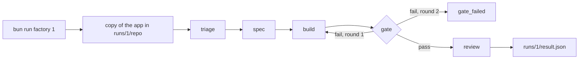
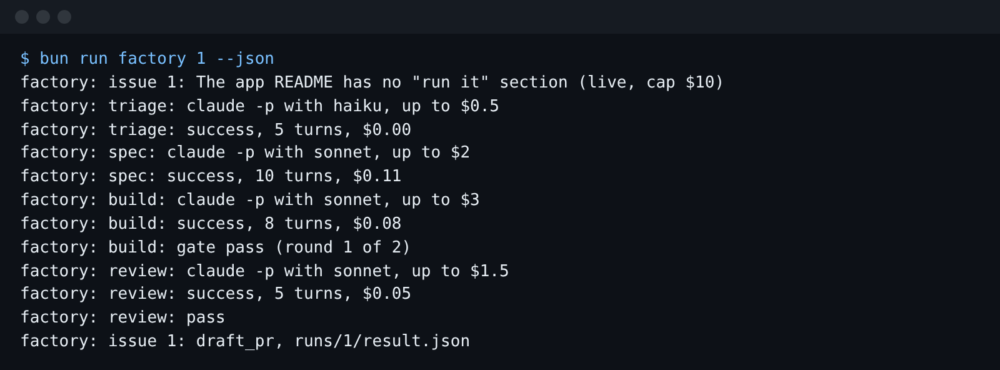

# Run one issue headless

## The problem

The factory must run with nobody at the keyboard. For that it uses `claude -p`: Claude Code gets one
prompt, works, prints its result and exits.

A `claude -p` call with no limits can loop and spend for a long time. And one flag, `--bare`, skips
the project's hooks. Then the test lock and the Stop gate from Part 4 vanish, and nothing tells you.

For example, `factory/run.ts` in this folder only prints `factory: not built yet` and exits 1.



## Your challenge

Get Claude Code to write `factory/run.ts`, the runner. `CLAUDE.md` in this folder holds the contract it must
answer. Start Claude Code here:

```bash
claude --add-dir ../../../../world --add-dir ../../../../checks
```

Expect: Claude Code opens and waits for your prompt.

Ask for a plan first:

```text
Read CLAUDE.md, factory/stages, factory/app and ../../../../checks/lib/result.ts. Then plan factory/run.ts, the runner for the factory contract in CLAUDE.md. Each stage is one claude -p call with a permission mode, its tools, --max-turns, --max-budget-usd and stream-json output, never --bare. The builder gets at most 2 gate rounds. Show me the flags per stage, how the retry loop stops, and what the dry run does. Write nothing yet.
```

Then try a dry run. It makes no `claude` call and spends nothing:

```bash
bun run factory 1 --dry-run --json
```

Expect: one JSON object with `"state": "draft_pr"`, `"pr_url": null` and `"cost_usd": 0`.

Last, run issue 1 for real. It costs about $0.25 of usage:

```bash
bun run factory 1 --json
```

Expect: the last progress line says `factory: issue 1: draft_pr, runs/1/result.json`.



## Done when

- The dry run of issue 1 prints one result in the contract's shape and saves it to `runs/1/result.json`.
- `commands.txt` lists one `claude -p` call per stage, each with its permissions, both caps and JSON output.
- Nothing uses `--bare`.
- Issue 6 stops at triage. A gate that keeps failing gets 2 build rounds, then `gate_failed`.
- A live run of issue 1 ends in `draft_pr`, and its cost is the sum of its transcripts.

```bash
bun run verify run-one-issue-headless
```

Expect: `Done. All 10 rules pass.`

## If you get stuck

| What you see | What to do |
| --- | --- |
| `Ignoring 5 permissions.allow entries ... has not been trusted` | Nothing. The copy is a new folder, so Claude Code skips its allow list. Each call names its own tools with `--allowedTools`, so the run still works. |
| `FAIL ... 2 rounds` | Run `FACTORY_DRY_GATE=fail bun run factory 1 --dry-run --json` and count the build lines in `runs/1/commands.txt`. |
| `FAIL a live run of issue 1 ...` | Run `claude auth status`. Then run issue 1 again without `--dry-run`. |

The prompts from a real run are in `../solution/prompts.md`.

## Words you will use

- **Headless**: Claude Code runs with no person to answer it. `claude -p` is the headless mode.
- **Dry run**: the factory does every step except the `claude` calls, so you can test it for free.
- **Transcript**: the stream-json lines one `claude -p` call printed. Its last line holds the cost.
- **Retry loop**: the builder gets one more round when the gate fails, up to a limit.
