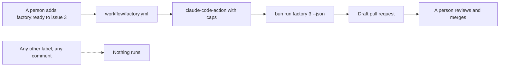

# Run from a label

## The problem

The factory runs on your laptop. The library wants it to start from GitHub: a coordinator adds a label to an
issue, and the factory runs on GitHub's machines.

The library already has one workflow, `workflow/claude.yml`. It starts Claude on any comment that says
`@claude`. It has no cap on turns or spend, no timeout, and no limit on runs at the same time.

For example, two volunteers who comment `@claude fix this` on issue 3 start two runs. Both spend, both
push, and nobody set a limit.



## Your challenge

Get Claude Code to write `workflow/factory.yml`. In your own repo the file goes in `.github/workflows/`.
Here it stays in this folder, so the check reads it with no GitHub account. Start Claude Code here:

```bash
claude --add-dir ../../../../world
```

Expect: Claude Code opens and waits for your prompt.

In plan mode, type:

```text
Read CLAUDE.md, factory/run.ts and workflow/claude.yml. Plan workflow/factory.yml: it runs the factory when a person adds the label factory:ready to an issue, and only then. It uses anthropics/claude-code-action@v1 and the CLAUDE_CODE_OAUTH_TOKEN secret, never a key in the file. It sets --max-turns and --max-budget-usd in claude_args, has one concurrency group per issue and a timeout, names its permissions, and opens the pull request as a draft. It never merges. Show me the plan and the YAML. Write nothing yet.
```

Read the YAML before you approve. Look for each line the Done when list asks for.

## Done when

- The workflow triggers only on `issues` with type `labeled`.
- Every job runs only when the label is `factory:ready`.
- It uses `anthropics/claude-code-action@v1` and signs in with a secret. No key is in the file.
- `claude_args` has `--max-turns` and `--max-budget-usd`.
- Each issue has its own concurrency group, and each job has `timeout-minutes`.
- Every job names its permissions.
- The pull request opens as a draft, and nothing merges it.

```bash
bun run verify run-from-a-label
```

Expect: `Done. All 8 rules pass.`

## If you get stuck

| What you see                                           | What to tell Claude Code                                                           |
| ------------------------------------------------------ | ---------------------------------------------------------------------------------- |
| `FAIL every job runs only for the label factory:ready` | "A labeled trigger fires for every label. Add an if on the job for factory:ready." |
| `FAIL ... signs in with a secret`                      | "Pass the token from secrets. Delete the key from the file."                       |
| `FAIL ... draft and never merges`                      | "Open the PR with gh pr create --draft, and remove any merge step."                |

The prompts from a real run are in `../solution/prompts.md`.

## Words you will use

- **Workflow**: a YAML file that tells GitHub Actions what to run, and when.
- **Trigger**: the event that starts a workflow, here a label added to an issue.
- **Secret**: a value GitHub stores for you and hands to the workflow. It never sits in a file.
- **Concurrency group**: GitHub runs one job per group at a time. One group per issue means one run per issue.
- **Draft pull request**: a pull request that cannot be merged until a person marks it ready.
