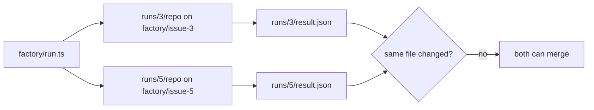
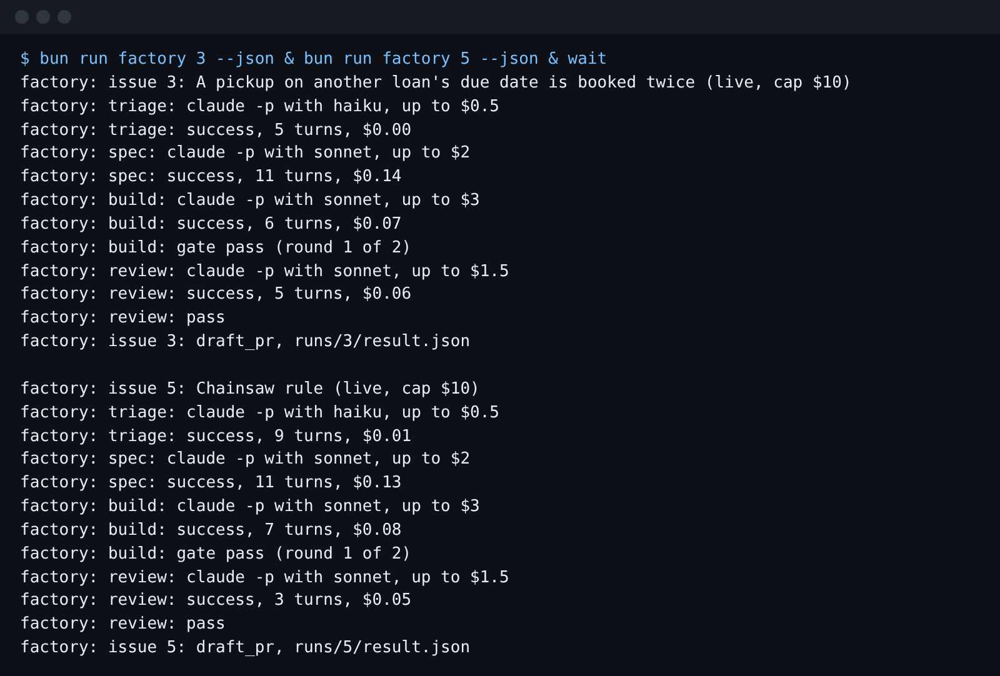

# Run two at once

This step is an elective. You can skip it and still finish the course.

## The problem

One run of the factory takes under a minute here, but a real backlog has many issues. You want two runs side
by side. Two runs that share a folder, a branch or a file break each other.

For example, issue 3 changes `src/loans/reserve.ts` and issue 5 changes `src/items/borrow.ts`. They touch
different files, so they can run at the same time. Two runs of issue 3 at once could not: each run deletes
its own `runs/3/` folder when it starts.



## Your challenge

First, ask Claude Code what the two runs could share. Start it here:

```bash
claude --add-dir ../../../../world
```

Expect: Claude Code opens and waits for your prompt.

In plan mode, type:

```text
I want to run issues 3 and 5 at the same time: bun run factory 3 --json and bun run factory 5 --json in two terminals. Read factory/run.ts, factory/backlog.json and the two issues in ../../../../world/backlog. Before I start them, tell me: will the two runs share any folder, git branch, gate record or app file? Name anything that could collide. Do not change any file.
```

Then leave Claude Code and start both runs. Together they cost about $0.55 of usage:

```bash
bun run factory 3 --json & bun run factory 5 --json & wait
```

Expect: two lines that end `draft_pr, runs/3/result.json` and `draft_pr, runs/5/result.json`.

Here are the two consoles from a real run, one under the other:



## Done when

- Issues 3 and 5 each have a live run, and each cost matches its transcripts.
- The two runs worked in different copies of the app, on different branches.
- Each run changed at least one file.
- No file was changed by both runs.

```bash
bun run verify run-two-at-once
```

Expect: `Done. All 4 rules pass.`

## If you get stuck

| What you see                                   | What to do                                                                                      |
| ---------------------------------------------- | ----------------------------------------------------------------------------------------------- |
| `FAIL issues 3 and 5 each have a live run ...` | Run both again without `--dry-run`. A dry run makes no `claude` call, so it has no transcripts. |
| `FAIL no file was changed by both runs`        | Pick two ready issues whose files in `factory/backlog.json` do not overlap.                     |

The prompts from a real run are in `../solution/prompts.md`.

## Words you will use

- **In parallel**: two runs at the same time, each in its own terminal.
- **Collision**: two runs that write the same folder, branch or file. One run breaks the other.
- **Copy of the app**: the folder `runs/<issue>/repo`, a git repo of its own. Here it plays the part of a
  git worktree: a second working folder, so two runs never share files.
