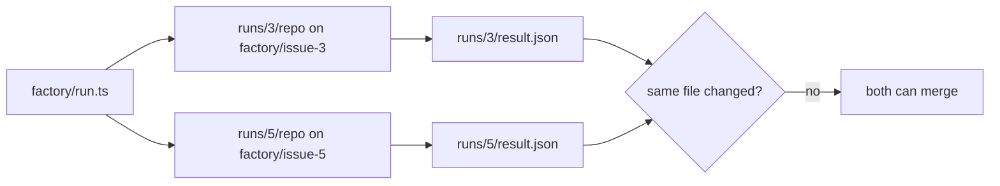

# Run two at once

## The problem

A real backlog has many issues, so you want two runs side by side. Runs that share a folder, a branch or a file
break each other.

For example, issue 3 changes `src/loans/reserve.ts` and issue 5 changes `src/items/borrow.ts`. Different files,
so they can run together. Two runs of issue 3 could not.



## Your challenge

First, ask Claude Code what the two runs could share. Start Claude Code:

```bash
cd parts/05-run-it-unattended/03-run-two-at-once/problem
claude --add-dir ../../../../world
```

Expect: Claude Code opens.

Press Shift+Tab until you see plan mode, then type:

```text
I want to run issues 3 and 5 at the same time: bun run factory 3 --json and bun run factory 5 --json in two terminals. Will the two runs share any folder, git branch, gate record or app file? Name anything that could collide. Change nothing.
```

Then leave Claude Code and start both runs:

```bash
bun run factory 3 --json & bun run factory 5 --json & wait
```

Expect: two lines that end `draft_pr, runs/3/result.json` and `draft_pr, runs/5/result.json`.


Now two runs that do change the same lines. The first merges. The second must rebase, which replays its work on
the new main. Git stops and leaves markers in `conflict/clash.ts`. Type:

```text
Run 3 made the dates inclusive. Run 5 skips a range with no start date. Both touched overlaps in conflict/clash.ts. Merge them so both changes stay, remove the markers, and run the gate again. Then fill in conflict/NOTES.md.
```

Expect: `conflict/clash.ts` has one `overlaps` function and no line that starts with `<<<<<<<`.

Then do the [session moves](SESSION-MOVES.md).

## Done when

- Issues 3 and 5 each have a live run, and each cost matches its transcripts.
- The two runs worked in different copies of the app, on different branches.
- Each run changed at least one file.
- No file was changed by both runs.
- `conflict/clash.ts` has no markers left, and it keeps both runs' changes.
- `conflict/NOTES.md` names the file, the fix, and the gate run after the rebase.
- Your saved session shows the session moves.

Ask Claude Code:

```text
Run `bun run verify run-two-at-once` and tell me what it printed. Do not change anything to make it pass.
```

```bash
bun run verify run-two-at-once
```

Expect: `Done. All 8 rules pass.`

## If you get stuck

| What you see                                   | What to do                                                                                      |
| ---------------------------------------------- | ----------------------------------------------------------------------------------------------- |
| `FAIL issues 3 and 5 each have a live run ...` | Run both again without `--dry-run`. A dry run makes no `claude` call, so it has no transcripts. |
| `FAIL the merged file keeps both ...`          | Do not pick a side. Keep both changes.                                                          |
| `FAIL no file was changed by both runs`        | Pick two ready issues whose files in `factory/backlog.json` do not overlap.                     |

## Words you will use

- **Collision**: two runs that write the same folder, branch or file.
- **Rebase**: replay your work on top of newer work. If both touched the same lines, Git stops and asks you to choose.
- **Copy of the app**: the folder `runs/<issue>/repo`, a git repo of its own. Here it plays the part of a
  git worktree: a second working folder, so two runs never share files.
