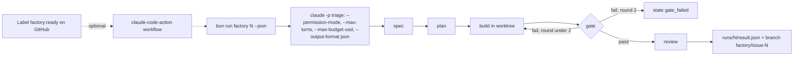

# Part 5: Run it unattended

Answers the question: **what stops it, and where does the result go?**

## The problem

The factory has to work when nobody is at the keyboard. For that, it runs `claude -p`. This runs Claude Code
with one prompt and no person to answer questions. It works, prints its result, and exits.

So the factory needs four things:

- the right flags for that stage,
- a cap on turns and on spend,
- a gate retry loop that gives up after 2 rounds,
- one result file per issue that says what happened.

Two flags can cause trouble. A bare `claude -p` now starts in a mode that denies anything that would ask you
first. And `--bare` skips hooks entirely. So the walls from Part 4 vanish, and nothing tells you.

For example, the finished factory runs triage on issue 2 with these flags, among others.

- `--permission-mode dontAsk` sets the permission mode.
- `--allowedTools Read,Grep,Glob` lets triage read and search, and nothing more.
- `--max-turns 12` stops it after 12 turns.
- `--max-budget-usd 0.5` stops it if it spends more than $0.50.

The run works in a copy of the app in `runs/finished-2/repo`. Its result file says
`"state": "draft_pr"`. The gate passed in round 1, and the whole run cost about $0.52. On issue 6 the result says `"state": "refused"` instead.

You ask Claude Code to write `factory/run.ts`. You read its plan, approve it, and run the check.

## Why it matters

Spotify runs Claude Code as a background agent. It reports "650+ agent-generated pull requests into production
per month". It also reports "up to 90%" time savings on complex code migrations. These come from Anthropic's
customer page, so they are a vendor claim (https://claude.com/customers/spotify).

Stripe "Migrated 10,000 lines of Scala to Java" with Claude Code (vendor claim:
https://claude.com/customers/stripe). Neither works without a gate in front of the merge.



| Step                         | Minutes | What you produce                                   | What its check reads                                                                                                                                                                                                                                                                                                                            |
| ---------------------------- | ------- | -------------------------------------------------- | ----------------------------------------------------------------------------------------------------------------------------------------------------------------------------------------------------------------------------------------------------------------------------------------------------------------------------------------------- |
| `run-one-issue-headless`     | 25      | `factory/run.ts` answering the factory contract    | `bun run factory 1 --dry-run --json` matches `checks/lib/result.ts`; every `claude -p` call sets a permission mode or allowed tools, `--max-turns`, `--max-budget-usd`, `--output-format json`, and never `--bare`; the retry loop stops at 2; a live run leaves branch `factory/issue-1` whose tests pass the local gate (`checks/lib/git.ts`) |
| `run-from-a-label`           | 25      | `.github/workflows/factory.yml` in the step folder | offline YAML: triggers only on the `factory:ready` label, uses a secret and never a literal key, sets `--max-turns` and `--max-budget-usd` in `claude_args`, has `concurrency` per issue and `timeout-minutes`, opens the PR as a draft                                                                                                         |
| `run-two-at-once` (elective) | 15      | two runs on issues 3 and 5 in two worktrees        | two result files with different worktrees and branches; no file changed on both branches                                                                                                                                                                                                                                                        |

## Walkthrough

TODO(part session): write each step's walkthrough and replace these Expect lines with real output.

```bash
bun run verify run-one-issue-headless
```

Expect: TODO(part session)

```bash
bun run verify run-from-a-label
```

Expect: TODO(part session)

```bash
bun run verify run-two-at-once
```

Expect: TODO(part session)
