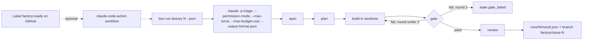

# Part 5: Run it unattended

Answers the question: **what stops it, and where does the result go?**

## The problem

The factory has to work when nobody is at the keyboard. That means `claude -p` with the right flags at each
stage, a cap on turns and spend, a gate retry loop that gives up, and one result file per issue that says what
happened. A bare `claude -p` now starts in a mode that denies anything that would prompt, and `--bare` skips
hooks entirely, so the walls from Part 4 vanish without a word.

## Why it matters

Spotify runs Claude Code as a background agent and reports "650+ agent-generated pull requests into
production per month" and "up to 90%" time savings on complex code migrations (Anthropic's customer page, a
vendor claim: https://claude.com/customers/spotify). Stripe "Migrated 10,000 lines of Scala to Java" with
Claude Code (vendor claim: https://claude.com/customers/stripe). Neither works without a gate in front of the
merge.



| Step | Minutes | What you produce | What its check reads |
|---|---|---|---|
| `run-one-issue-headless` | 25 | `factory/run.ts` answering the factory contract | `bun run factory 1 --dry-run --json` matches `checks/lib/result.ts`; every `claude -p` call sets a permission mode or allowed tools, `--max-turns`, `--max-budget-usd`, `--output-format json`, and never `--bare`; the retry loop stops at 2; a live run leaves branch `factory/issue-1` whose tests pass the local gate (`checks/lib/git.ts`) |
| `run-from-a-label` | 25 | `.github/workflows/factory.yml` in the step folder | offline YAML: triggers only on the `factory:ready` label, uses a secret and never a literal key, sets `--max-turns` and `--max-budget-usd` in `claude_args`, has `concurrency` per issue and `timeout-minutes`, opens the PR as a draft |
| `run-two-at-once` (elective) | 15 | two runs on issues 3 and 5 in two worktrees | two result files with different worktrees and branches; no file changed on both branches |

## Walkthrough

TODO(part session): write each step's walkthrough and replace these Expect lines with real output.

```bash
bun run verify run-one-issue-headless
```

Expect: TODO(part session)

```bash
bun run verify run-from-a-label
```

Expect: TODO(part session)

```bash
bun run verify run-two-at-once
```

Expect: TODO(part session)
