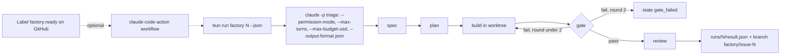

# Run it unattended

Moves the **Objective**: Claude Code turns one issue into one draft pull request with nobody watching.

Answers the question: **what stops it, and where does the result go?**

## The problem

The factory has to work when nobody is at the keyboard. For that, it runs `claude -p`. This runs Claude Code
with one prompt and no person to answer questions. It works, prints its result, and exits.

So the factory needs four things:

- the right flags for that stage,
- a cap on turns and on spend,
- a gate retry loop that gives up after 2 rounds,
- one result file per issue that says what happened.

Two flags can cause trouble. A `claude -p` call with no permission mode starts in
Manual mode, and it denies anything that would ask you first. And `--bare` skips the project's hooks
(https://code.claude.com/docs/en/headless). So the walls from the "Gate the agent" part vanish, and nothing tells you.

For example, the finished factory runs triage on issue 2 with these flags, among others.

- `--permission-mode dontAsk` sets the permission mode.
- `--allowedTools Read,Grep,Glob` lets triage read and search, and nothing more.
- `--max-turns 12` stops it after 12 turns.
- `--max-budget-usd 0.5` stops it if it spends more than $0.50.

The run works in a copy of the app in `runs/finished-2/repo`. Its result file says
`"state": "draft_pr"`. The gate passed in round 1, and the whole run cost about $0.52. On issue 6 the result says `"state": "refused"` instead.

You ask Claude Code to write `factory/run.ts`. You read its plan, steer it, and run the factory on a real
issue. Then you start the same factory from a GitHub label, and run two issues side by side.

## Why it matters

Spotify runs Claude Code as a background agent. Its background coding agent makes "650+ pull requests per
month", merged into production. It also reports "Up to 90% time savings" on complex migrations. These come
from Anthropic's customer page, so they are a vendor claim (https://claude.com/customers/spotify).

Stripe "Migrated 10,000 lines of Scala to Java" with Claude Code (vendor claim:
https://claude.com/customers/stripe). Neither works without a gate in front of the merge.



| Step                         | Minutes | What you produce                                   |
| ---------------------------- | ------- | -------------------------------------------------- |
| `run-one-issue-headless`     | 25      | `factory/run.ts`, and a live run of issue 1        |
| `run-from-a-label`           | 25      | `workflow/factory.yml`, started by `factory:ready` |
| `run-two-at-once` (elective) | 15      | live runs of issues 3 and 5, side by side          |

Each step's files go in that step's `problem/` folder. You start Claude Code there, give it the job, read its
plan, and check what it wrote. Each step's `solution/prompts.md` shows the prompts from a real run.

A live run costs real usage on your Claude plan. In the real runs behind this part, issue 1 cost $0.24, and
issues 3 and 5 cost $0.28 and $0.26. The dry run is free: `bun run factory 1 --dry-run --json`.

## Walkthrough

You can ask Claude Code to run any check below. Type:

```text
Run this command and tell me what it printed. Do not change anything to make it pass.
```

The raw commands are:

Inside `parts/05-run-it-unattended/01-run-one-issue-headless/problem/`, after Claude Code wrote the runner:

```bash
bun run factory 1 --dry-run --json
```

Expect: one JSON object with `"state": "draft_pr"`, `"pr_url": null` and `"cost_usd": 0`.

```bash
bun run factory 1 --json
```

Expect: the last progress line says `factory: issue 1: draft_pr, runs/1/result.json`.

Back at the repo root:

```bash
bun run verify run-one-issue-headless
```

Expect: `Done. All 10 rules pass.`

```bash
bun run verify run-from-a-label
```

Expect: `Done. All 8 rules pass.`

Inside `parts/05-run-it-unattended/03-run-two-at-once/problem/`:

```bash
bun run factory 3 --json & bun run factory 5 --json & wait
```

Expect: two lines that end `draft_pr, runs/3/result.json` and `draft_pr, runs/5/result.json`.

Back at the repo root:

```bash
bun run verify run-two-at-once
```

Expect: `Done. All 4 rules pass.`

```bash
bun run verify part run-it-unattended
```

Expect: `Part run-it-unattended is done: 3/3 steps pass.`

Compare with the sample answers at any time, for example `bun run verify run-one-issue-headless solution`.

## Go further

Run the finished factory on one issue with a lower `--max-turns`, such as 3. Read the result file and write down what stopped the run and what was lost. The check does not grade this.

## Finished

You now have a factory that runs with nobody at the keyboard. `bun run factory <issue>` takes one issue to a
branch whose gate is green and a review that passed. Every `claude -p` call names its tools and caps its turns
and spend. A GitHub label can start it, and two issues can run side by side.

What you do not know yet is what each run costs per stage, or how to stop a run that spends too much.
The "Price and ship" part gives each stage a model by its role. It caps a whole run. Then it runs the factory
over all seven issues.
