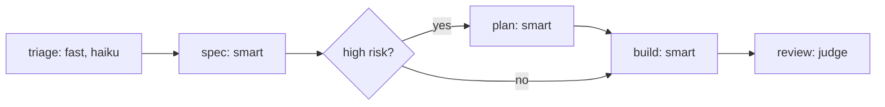
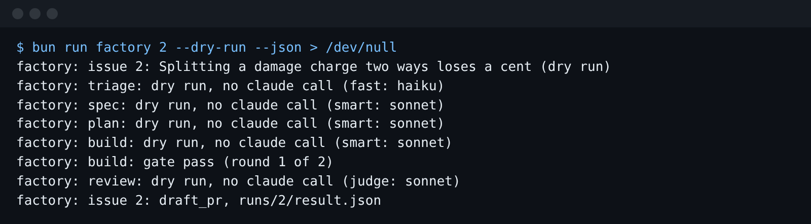

# Route models by stage

## The problem

Every stage runs on the same model. Triage only reads one issue, but it runs on
the same smart model as the builder.

For example, run a dry run of issue 1 in this folder and read `runs/1/commands.txt`. The triage line says
`--model sonnet`, the same as the build line.

The other way round is risky too. Issue 2 moves money, but nothing plans before the builder starts.



## Your challenge

Get Claude Code to give each stage a model by its role. A **role** names a kind of model: fast, smart or
judge. One map turns a role into a Claude Code alias.

Start Claude Code from the repo root:

```bash
cd parts/06-price-and-ship/01-route-models-by-stage/problem
claude --add-dir ../../../../world --add-dir ../../../../checks
```

Expect: Claude Code opens and waits for your prompt.

Press Shift+Tab until you see plan mode ([ways of working](../../../../00-orientation/ways-of-working.md)), then type:

```text
Every stage in factory/run.ts runs on the smart role, even triage, which only reads. Plan a change so each stage gets a model by its role. Each file in factory/stages starts with a frontmatter block that names its role: triage fast, spec smart, build smart, review judge. Add a plan stage, factory/stages/plan.md, on the smart role. It writes specs/<issue>/PLAN.md before the build, and runs only for high-risk issues. In a dry run, an issue labelled money, privacy or safety is high risk. run.ts maps roles to aliases in one place: fast haiku, smart sonnet, judge sonnet. Never a full model id. Show me the plan. Write nothing yet.
```

When the plan is right, press Shift+Tab until plan mode is off, then type:

```text
Go ahead. Make the changes in factory/run.ts and factory/stages now.
```

Then type `/exit` and run a free dry run:

```bash
bun run factory 2 --dry-run --json > /dev/null
```

Expect: triage says `(fast: haiku)`, and a `plan` line says `(smart: sonnet)`.



## Done when

- Every file in `factory/stages` names its role in frontmatter.
- Triage is fast. Spec, plan and build are smart. Review is judge.
- Issue 2 runs a plan stage. Issue 1 never does.
- Every `claude -p` call uses its role's alias, never a full model id.

Ask Claude Code:

```text
Run `bun run verify route-models-by-stage` and tell me what it printed. Do not change anything to make it pass.
```

```bash
bun run verify route-models-by-stage
```

Expect: `Done. All 6 rules pass.`

## If you get stuck

| What you see                                    | What to tell Claude Code                                     |
| ----------------------------------------------- | ------------------------------------------------------------ |
| `FAIL ... runs triage on the fast role`         | "Read the role from the stage file, not from a fixed model." |
| `FAIL issue 1 (docs) never runs the plan stage` | "Run the plan stage only for high-risk issues."              |

The prompts from a real run are in `../solution/prompts.md`.

## Words you will use

- **Role**: a name for the kind of model a stage needs. Fast is cheap, smart reasons well, judge grades.
- **Alias**: the short name Claude Code takes in `--model`, such as `haiku` or `sonnet`.
- **Frontmatter**: a small block between two `---` lines at the top of a file, with settings in it.
- **High risk**: an issue that touches money, privacy or safety. It gets a plan before the build.
