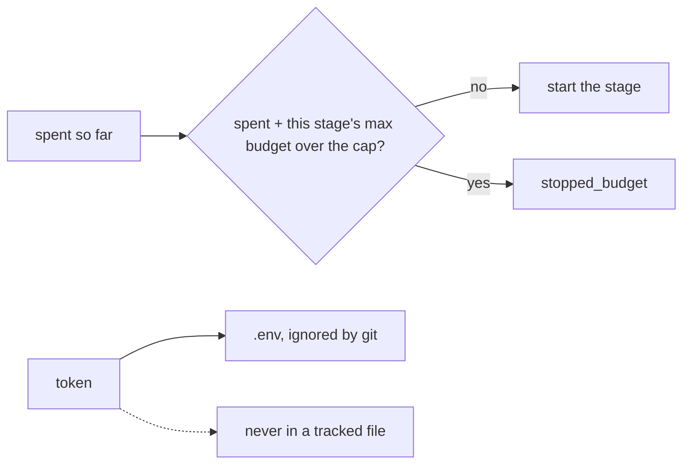
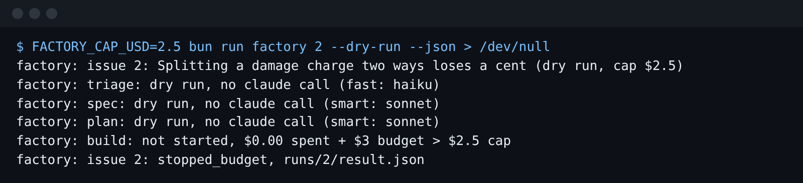

# Cap the spend

## The problem

The factory has a run cap, `FACTORY_CAP_USD`. But it only looks at money already spent. So a run with $1 left
can still start the build stage, which may spend up to $3.

For example, in this folder a dry run with a cap of $0.05 still ends in `draft_pr`:

```bash
FACTORY_CAP_USD=0.05 bun run factory 1 --dry-run --json
```

Expect: `"state": "draft_pr"`. Every stage started, even though one stage alone may spend $0.50.

There is a second problem. `factory/ci.env` is a tracked file, and someone pasted a token into it. The token
here is a fake one, but a real one in git can be read by anyone who can read the repo.



## Your challenge

Get Claude Code to check the cap before each stage starts, and to move the token out of every tracked file.
Start Claude Code here:

```bash
claude --add-dir ../../../../world --add-dir ../../../../checks
```

Expect: Claude Code opens and waits for your prompt.

In plan mode, type:

```text
The run cap FACTORY_CAP_USD only looks at money already spent. Plan a change so that before each stage starts, run.ts adds that stage's --max-budget-usd to the spend so far. If the total would go over the cap, the stage does not start and the run ends as stopped_budget. A dry run follows the same rule. Keep the default cap at 10. Also, factory/ci.env is a tracked file with a token in it. Plan how to move the token into a git-ignored .env, and say what the build server should use instead. Write nothing yet.
```



## Done when

- With `FACTORY_CAP_USD=0.05`, a dry run of issue 1 ends `stopped_budget` before triage.
- With `FACTORY_CAP_USD=2.5`, issue 2 stops, and no stage it started could spend over $2.50.
- With the default cap, a dry run of issue 1 still ends in `draft_pr`.
- No file in the folder holds a token, apart from `.env`, and `.gitignore` keeps `.env` out of git.

```bash
bun run verify cap-the-spend
```

Expect: `Done. All 5 rules pass.`

## If you get stuck

| What you see                                   | What to tell Claude Code                                          |
| ---------------------------------------------- | ----------------------------------------------------------------- |
| `FAIL with FACTORY_CAP_USD=0.05 ...`           | "Check the cap before a stage starts, with its max budget added." |
| `FAIL no file in the folder holds a token ...` | "Search for sk-ant- and move it to .env."                         |

The prompts from a real run are in `../solution/prompts.md`.

## Words you will use

- **Cap**: the most one run may spend. The factory reads it from `FACTORY_CAP_USD`.
- **Max budget**: what one stage may spend, set with `--max-budget-usd`. Claude Code stops the stage there.
- **Token**: the secret that signs Claude Code in. Make one for a server with `claude setup-token`.
- **Tracked file**: a file git keeps. Anyone who can read the repo can read it, even after you delete it.
