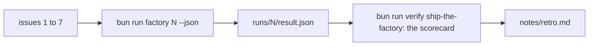

# Ship the factory

## The problem

You built every part of the factory one step at a time. Nobody has run it on the whole backlog yet. Until you
do, you cannot say what one issue costs, or which gate does the real work.

For example, Anthropic's cost page gives an average of "$150-250 per developer per month" for Claude Code
(https://code.claude.com/docs/en/costs). That is across enterprise teams. That is someone else's number. This step
gives you your own, per issue and per stage.



## Your challenge

Run the factory on every issue, one at a time. In the real run behind this step, the seven cost $1.53 of usage together:

```bash
for issue in 1 2 3 4 5 6 7; do bun run factory $issue --json > /dev/null; done
```

Expect: seven last lines. Issues 1 to 5 end `draft_pr`, issue 6 ends `refused`, issue 7 ends `stopped_at_plan`.

Then ask Claude Code to read the runs with you and write the retro. Start Claude Code here:

```bash
claude
```

Expect: Claude Code opens and waits for your prompt.

Type this prompt:

```text
Read runs/*/result.json and the console lines in runs/*. Make a table: issue, state, roles by stage, gate rounds, review verdict, cost. Then fill in notes/retro.md under its three headings: a gate that fired (a real one, from the runs), what it cost (the total and the most expensive stage, in dollars), and what I change next. Use only numbers from the runs.
```

Read the retro. Every number in it must match a result file.


## Done when

- Issues 1 to 7 each have a live run, and each cost matches its transcripts.
- At least 3 of issues 1 to 5 reach `draft_pr`, with the gate green and the review passing.
- No run edited a test file in the build stage.
- Issue 6 is refused, and issue 7 stops at the plan.
- Issues 2 and 4 plan on the smart role. Issue 1 does not plan.
- The seven runs cost under $5 together.
- `notes/retro.md` answers its three headings, and "What it cost" names a dollar amount.

```bash
bun run verify ship-the-factory
```

Expect: `Done. All 7 rules pass.`

## If you get stuck

| What you see                                    | What to do                                                                                   |
| ----------------------------------------------- | -------------------------------------------------------------------------------------------- |
| A run with no `result.json`                     | It was stopped before it ended. Run that issue again.                                        |
| `FAIL the high-risk issues 2 and 4 planned ...` | Read the triage transcript. Ask Claude Code to make triage call money and privacy high risk. |
| `FAIL notes/retro.md answers ...`               | Write a few sentences under each heading, with a dollar amount under "What it cost".         |

The prompts from a real run are in `../solution/prompts.md`.

## Words you will use

- **Scorecard**: the list of targets your factory must meet. `bun run verify ship-the-factory` prints it.
- **Retro**: short for retrospective, a note on what went well, what it cost, and what you change next.
- **Cost per issue**: `cost_usd` in one result file, the sum of what Claude Code reported for each stage.
