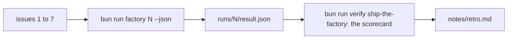
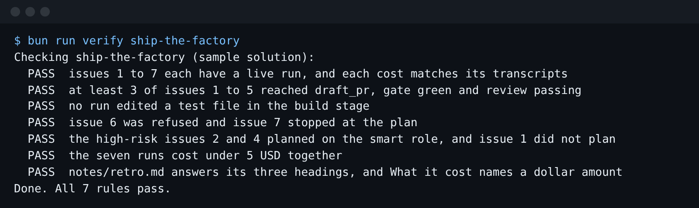

# Ship the factory

## The problem

Nobody has run the factory on the whole backlog, so you cannot say what one issue costs. For example, issue 4 cost $0.41 in the real run. This step gives you your own numbers.



## Your challenge

Run the factory on every issue, one at a time. The seven cost $1.53 together in the real run:

```bash
cd parts/06-price-and-ship/03-ship-the-factory/problem
for issue in 1 2 3 4 5 6 7; do bun run factory $issue --json > /dev/null; done
```

Expect: seven last lines. Issues 1 to 5 end `draft_pr`, issue 6 ends `refused`, issue 7 ends `stopped_at_plan`.

Then start Claude Code to write the retro:

```bash
claude
```

Expect: Claude Code opens.

Type this prompt:

```text
Read runs/*/result.json and the console lines in runs/*. Make a table: issue, state, gate rounds, review verdict, cost. Then fill in notes/retro.md under its headings. Use only numbers from the runs.
```

Every number in the retro must match a result file. Now make cost visible and prove a change helps:

```text
Add CLAUDE_CODE_ENABLE_TELEMETRY=1 and OTEL_METRICS_EXPORTER=console to factory/ci.env, with no token in it. Then change one setting of the stage that cost the most, such as its --max-turns. Touch nothing else.
```

Run all seven issues again, and keep the new runs apart from the first ones:

```bash
for issue in 1 2 3 4 5 6 7; do FACTORY_RUNS=rerun/runs bun run factory $issue --json > /dev/null; done
```

Expect: seven last lines again, and a new `rerun/runs/` folder. Under "Before and after" in the retro, write the old total, the rerun total and the one setting you changed.



## Done when

- Issues 1 to 7 each have a live run, and each cost matches its transcripts.
- At least 3 of issues 1 to 5 reach `draft_pr`, gate green, review passing.
- No run edited a test file in the build stage.
- Issue 6 is refused, and issue 7 stops at the plan.
- Issues 2 and 4 plan on the smart role. Issue 1 does not.
- The seven runs cost under $5 together.
- `notes/retro.md` answers its three headings, and "What it cost" names a dollar amount.
- `factory/ci.env` turns telemetry on and holds no secret.
- "Before and after" names one changed setting. It has two costs, and the first is the real total of your first runs.

Ask Claude Code:

```text
Run `bun run verify ship-the-factory` and tell me what it printed. Do not change anything to make it pass.
```

```bash
bun run verify ship-the-factory
```

Expect: `Done. All 9 rules pass.`

## If you get stuck

| What you see                                    | What to do                                                                                   |
| ----------------------------------------------- | -------------------------------------------------------------------------------------------- |
| `FAIL the high-risk issues 2 and 4 planned ...` | Read the triage transcript. Ask Claude Code to make triage call money and privacy high risk. |
| `FAIL notes/retro.md answers ...`               | Write a few sentences under each heading, with a dollar amount under "What it cost".         |

## Words you will use

- **Scorecard**: the targets your factory must meet.
- **Retro**: a note on what went well, what it cost, and what you change next.
- **OTel**: short for OpenTelemetry, an open standard for reporting what a program did. Claude Code uses it to report cost and tokens.
