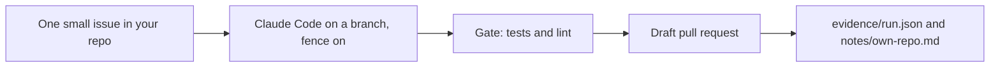

# Run one issue on your repo

## The problem

So far the factory ran on the library, which someone else built. A factory that works only on the library
proves little. You need one real run on a repo you own.

For example, a learner picks a small issue in their own recipe repo: scale a recipe by a number. One run, one
draft pull request, and a cost of $0.34.



## Your challenge

Work in your own repo, not in this course folder. Copy the `evidence/` and `notes/` folders from `problem/` into
it. Start Claude Code in your own repo:

```bash
claude
```

Expect: Claude Code opens.

Press Shift+Tab until you see plan mode, then type:

```text
Read this repo and its open issues. Pick one issue that changes one or two files and has an outcome I can check by reading. Tell me why it is a good first one. Change nothing.
```

Then press Shift+Tab until plan mode is off, and type:

```text
Work on that issue on a branch named factory/issue-<number>. Do not edit any test file. Run the tests and the lint. Open a draft pull request. Never merge.
```

Last, ask for the evidence:

```text
Fill in evidence/run.json with the repo, issue, branch, pull request link, whether it is a draft, whether the gate passed, the files changed, the cost and the cap. Save the gate output to evidence/gate.txt and a copy of .claude/settings.json to evidence/claude-settings.json. Then fill in notes/own-repo.md. Use only what really happened.
```

Copy `evidence/` and `notes/` back into this step's `problem/` folder, then run the check on it.

## Done when

- `evidence/run.json` names your own repo, not the library, and an issue number.
- The branch is not main, and the pull request link is a draft.
- The gate passed, no test file was edited, and some file changed.
- The cost is above zero and under the cap.
- `evidence/gate.txt` has the gate output, and your settings file has deny rules.
- `notes/own-repo.md` answers its four headings.

Ask Claude Code:

```text
Run `bun run verify run-one-issue-on-your-repo` and tell me what it printed. Do not change anything to make it pass.
```

```bash
bun run verify run-one-issue-on-your-repo
```

Expect: `Done. All 7 rules pass.`

## If you get stuck

| What you see                             | What to do                                                           |
| ---------------------------------------- | -------------------------------------------------------------------- |
| `FAIL evidence/run.json names your repo` | Put your own `owner/name` in it. The library is a practice repo.     |
| `FAIL the pull request is a draft ...`   | Paste the real pull request link and set `draft` to true.            |
| `FAIL the cost is above zero ...`        | Read the cost from your Claude Code usage and write the real number. |

## Words you will use

- **Evidence**: files that show what really happened, so a person can check your claim.
- **Draft pull request**: a pull request that cannot be merged until a person marks it ready.
- **Cap**: the most one run may spend.
