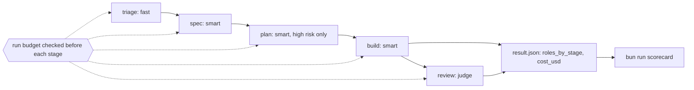

# Price and ship

Moves the **Goal**: your factory runs all seven Northside issues and meets the scorecard.

Answers the question: **what did it cost, and was it worth it?**

## The problem

Nobody at the library can say what one pull request from the factory costs. Every stage runs on the same
large model. Nothing stops a run that loops. The only number anyone has is a monthly bill.

You fix this in three moves, each one a prompt to Claude Code.

- Give each stage a model by its role. A role is a name for a kind of model: fast, smart or judge.
- Put a cap on what one run may spend.
- Run the factory over the whole backlog and score it.

For example, here is what the real run of the whole backlog in this part cost, stage by stage, across all
seven issues.

| Stage  | Role  | Cost in USD |
| ------ | ----- | ----------- |
| triage | fast  | 0.03        |
| spec   | smart | 0.58        |
| plan   | smart | 0.27        |
| build  | smart | 0.34        |
| review | judge | 0.31        |
| total  |       | 1.53        |

Triage is cheap because it only reads. Issue 6 was refused at triage for less than a cent. These numbers
come from `03-ship-the-factory/solution/runs/*/result.json`.

A **scorecard** is the last report. `bun run scorecard` reads every result file and says which targets you
met.

## Why it matters

Anthropic's cost page (https://code.claude.com/docs/en/costs) gives an average of "$150-250 per developer
per month". That is across enterprise deployments. It adds: "Per-developer costs vary widely based on model
selection, codebase size, and usage patterns such as running multiple instances or automation".

A factory is that kind of automation. Anthropic's own harness research ran at $200 against $9 for a solo run
(https://www.anthropic.com/engineering/harness-design-long-running-apps). So the course ends with your own
number, per issue and per stage. You measure it. It is not a vendor's number.



| Step                    | Minutes | What you produce                                         |
| ----------------------- | ------- | -------------------------------------------------------- |
| `route-models-by-stage` | 15      | a role in each stage file, and a plan stage on high risk |
| `cap-the-spend`         | 10      | a cap checked before each stage, the token out of git    |
| `ship-the-factory`      | 25      | live runs of issues 1 to 7, and `notes/retro.md`         |

Each step's files go in that step's `problem/` folder. You start Claude Code there, give it the job, read its
plan, and check what it wrote. Each step's `solution/prompts.md` shows the prompts from a real run.

## Walkthrough

Inside `parts/06-price-and-ship/01-route-models-by-stage/problem/`, after Claude Code made the change:

```bash
bun run factory 2 --dry-run --json > /dev/null
```

Expect: triage says `(fast: haiku)`, and a `plan` line says `(smart: sonnet)`.

Back at the repo root:

```bash
bun run verify route-models-by-stage
```

Expect: `Done. All 6 rules pass.`

Inside `parts/06-price-and-ship/02-cap-the-spend/problem/`:

```bash
FACTORY_CAP_USD=2.5 bun run factory 2 --dry-run --json > /dev/null
```

Expect: `factory: build: not started, $0.00 spent + $3 budget > $2.5 cap`, then `stopped_budget`.

Back at the repo root:

```bash
bun run verify cap-the-spend
```

Expect: `Done. All 5 rules pass.`

Inside `parts/06-price-and-ship/03-ship-the-factory/problem/`. This one costs real usage, about $1.50:

```bash
for issue in 1 2 3 4 5 6 7; do bun run factory $issue --json > /dev/null; done
```

Expect: issues 1 to 5 end `draft_pr`, issue 6 ends `refused`, issue 7 ends `stopped_at_plan`.

Back at the repo root, after Claude Code wrote `notes/retro.md`:

```bash
bun run verify ship-the-factory
```

Expect: `Done. All 7 rules pass.`

```bash
bun run verify part price-and-ship
```

Expect: `Part price-and-ship is done: 3/3 steps pass.`

Compare with the sample answers at any time, for example `bun run verify ship-the-factory solution`.

## Go further

Pick the issue that cost the most. Write one change to its prompt or flags that you think would cut the cost, then run it again and compare the two costs. The check does not grade this.

## Finished

You now have the whole factory. A typed issue goes in. Out comes a branch whose gate is green, a review that
passed, and a result file with the cost of every stage. Each stage runs on the model its role needs. No run
starts a stage it cannot afford, and no token sits in git.

You also have your own number: what one issue costs, per stage. In the real run here it was $0.26 to $0.41
for a fixed issue, and under a cent for a refused one. The retro names what you change next. In the real run,
that was the plan stage, whose write rule never matched. Reading the runs found it, not the scorecard. That is
the habit to keep: the scorecard says the factory works, and the runs say how.
