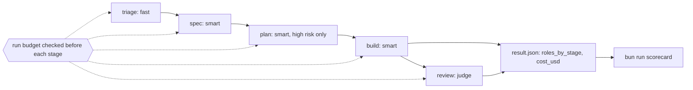

# Part 6: Price and ship

Answers the question: **what did it cost, and was it worth it?**

## The problem

Nobody at the library can say what one pull request from the factory costs. Every stage runs on the same
large model, nothing stops a run that loops, and the only number anyone has is a monthly bill. You finish by
running the factory over the whole backlog and scoring it.

## Why it matters

Anthropic's cost page gives an average of "$150-250 per developer per month" across enterprise deployments,
and says "Per-developer costs vary widely based on model selection, codebase size, and usage patterns such as
running multiple instances or automation" (https://code.claude.com/docs/en/costs). A factory is exactly that
automation. Anthropic's own harness research ran at $200 against $9 for a solo run
(https://www.anthropic.com/engineering/harness-design-long-running-apps). So the course ends with your own
measured number, per issue and per stage, not a vendor's.



| Step | Minutes | What you produce | What its check reads |
|---|---|---|---|
| `route-models-by-stage` | 15 | a model per agent, set by role | each agent file sets `model`; `result.json` records `roles_by_stage`; a high-risk issue plans on the smart role; the docs issue never does |
| `cap-the-spend` | 10 | a run budget in `factory/run.ts`, the key kept in `.env` | with `FACTORY_CAP_USD=0.05` the run ends with state `stopped_budget`; a secret scan of tracked files finds no key |
| `ship-the-factory` | 25 | runs over issues 1 to 7, the scorecard, `notes/retro.md` | `bun run scorecard`: 3 of issues 1 to 5 at `draft_pr` with branches whose tests pass the local gate, 0 test files edited, issue 3 blocked once, issue 6 refused, issue 7 stopped at plan, cost under the cap, `cost_usd` equal to the summed `total_cost_usd` of the logged calls; the retro has three headings with text |

## Walkthrough

TODO(part session): write each step's walkthrough and replace these Expect lines with real output.

```bash
bun run verify route-models-by-stage
```

Expect: TODO(part session)

```bash
bun run verify cap-the-spend
```

Expect: TODO(part session)

```bash
bun run verify ship-the-factory
```

Expect: TODO(part session)
