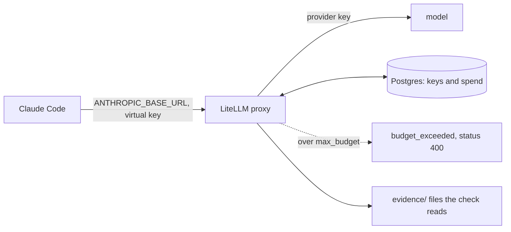

# Track agent cost with LiteLLM

Optional in the live session. Expected as homework.

## The problem

In the last part you capped the spend with a script that checks a budget before each stage. That works only
while every run goes through your script. Anything that calls the model another way is not capped.

A **gateway** is a small server between Claude Code and the model. Every request passes through it, so it can
count spend and refuse requests. Teams run an open-source gateway called LiteLLM for this.

For example, a run started by hand skips your script and its cap. Through the gateway, it is counted too.



## Your challenge

Work in the `assignment/` folder at the repo root.
Claude Code's gateway docs (https://code.claude.com/docs/en/llm-gateway) describe the base URL setting.
Anthropic does not endorse third-party gateways. A gateway key bills per token, so keep the budget at cents.

Make a `.env` with a generated master key. The key goes to the file, never to your screen:

```bash
cd assignment
printf 'LITELLM_MASTER_KEY=sk-%s\n' "$(openssl rand -hex 24)" >> .env
```

Expect: no output. Open `.env` in your editor and add `ANTHROPIC_API_KEY` and `UPSTREAM_MODEL`. The model id
is the one in `config/claude-code.ts`.

Start Claude Code in `assignment/`. Write each prompt in `prompts.md` as you go. Ask it to:

- write `litellm.yaml` with one model name, reading secrets from `.env`,
- start the stack and make a virtual key with `max_budget` 0.05,
- run one factory stage through the proxy,
- save the key info, then send requests until the proxy refuses one,
- stop the stack with `docker compose down -v`.

Expect: the first stage runs. Once spend passes the budget, the next request is refused by the proxy.

Then run the check from the repo root:

```bash
bun assignment/check.ts
```

Expect: `Done. All 5 lines pass.` and a new `assignment/result.json`.

## Done when

- The LiteLLM image is pinned to `v1.109.1`.
- A virtual key exists with `max_budget` set.
- One stage completed through the proxy, and the key's spend is above zero.
- A request after the budget was spent was refused.
- No key appears in the repo.

```bash
bun run verify track-agent-cost
```

Expect: `Done. All 5 rules pass.`

Push a branch named `assignment` and send its URL. The grader runs the same check, then reads your prompts
and `CHOICE.md`.

## Options

**Option: agentgateway.** It is a small open-source gateway that also fronts MCP servers.

- Choose when: you also front MCP servers and want one small binary.
- Trade-off: per-key spend tracking is LiteLLM's home ground.

Write your answer in `CHOICE.md`.

## If you get stuck

| What you see                      | What to tell Claude Code                             |
| --------------------------------- | ---------------------------------------------------- |
| `FAIL no key appears in any file` | "Search for sk- outside .env and move it into .env." |

The prompts are in `../solution/prompts.md`.

## Words you will use

- **Gateway**: a server between Claude Code and the model that every request passes through.
- **Virtual key**: a key the gateway makes for you. It has its own budget and is not your provider key.
- **Max budget**: the most a virtual key may spend, in US dollars. After that the gateway refuses requests.
