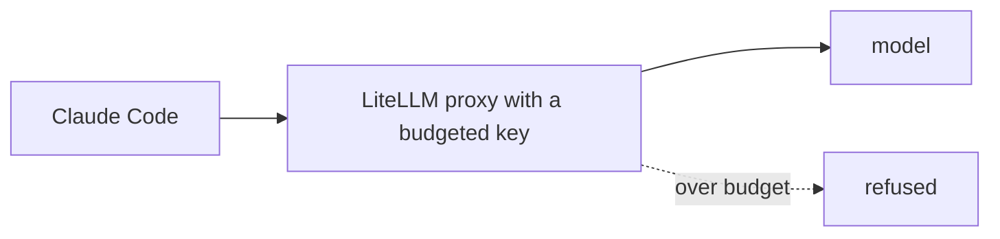

# Part 7: Track agent cost with LiteLLM

Moves the **Goal**: the spend cap you built by hand now lives in the open-source gateway teams run.

Answers the question: **can anything go around my cap?**

## The problem

Your cap lives in the factory script. A run that does not use the script is not capped. A gateway counts
spend for every request that passes through it. This part is short, and it is optional in the live session.

For example, a run started by hand in a terminal never touches the factory script. The gateway still counts it.



| Step               | Minutes | What you produce                                         |
| ------------------ | ------- | -------------------------------------------------------- |
| `track-agent-cost` | 15      | `prompts.md`, and the proxy's key info and refusal saved |

## Walkthrough

At the repo root, after Claude Code did the work in `assignment/`:

```bash
bun assignment/check.ts
```

Expect: `Done. All 5 lines pass.`

```bash
bun run verify track-agent-cost
```

Expect: `Done. All 5 rules pass.`

Compare with the sample answer at any time:

```bash
bun run verify track-agent-cost solution
```

Expect: `Done. All 5 rules pass.`

## Finished

You moved one hand-built idea onto a real tool. The cap is now a key with a budget, and the proxy says no
when it is spent.
