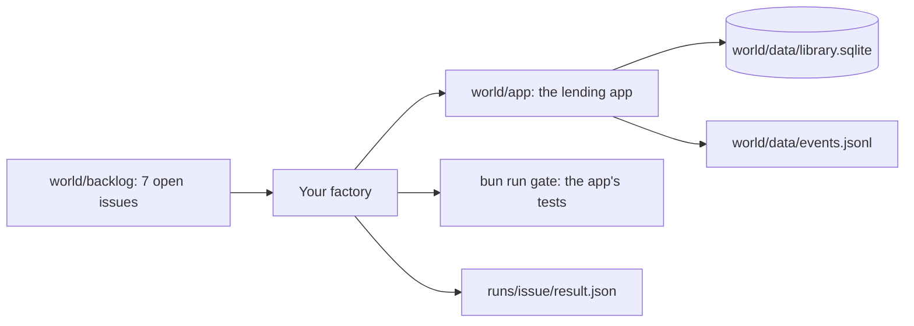

# The world: Northside Tool Library

Northside Tool Library is a member-run library that lends tools: drills, ladders, a pressure washer, a
chainsaw. Members pay a deposit, borrow a tool, and bring it back by its due date. Volunteers run the desk.

You are the library's volunteer engineer. You have very little time, and the backlog keeps growing. Two of
the open issues are about money and privacy. That is why you are building a factory: a line that takes one
issue and hands back a draft pull request you can trust, with its cost on record.

Northside is fictional. Its rules are the ones the desk keeps: a late fee for every late return, damaged
tools marked as not lendable, and safety classes that need an induction.



## Commands

```bash
bun run world
```

Expect: `world: Northside Tool Library is ready: 12 tools, 8 members, 4 loans out (1 overdue), 7 open issues.`

```bash
bun run world reset
```

Expect: `world: reset to the seed.` and the same counts. It also clears `runs/` and the event log.

```bash
bun run gate
```

Expect: `gate: pass, 10 tests` and a tree hash.

```bash
bun run desk split D-301
```

Expect: `desk: charge £33.33, shares add up to £33.32`. That missing penny is issue 2.

## What is in it

| Path | Holds |
|---|---|
| `app/` | the lending app: TypeScript on Bun, Hono for the web page and API, `bun:sqlite` for data |
| `app/src/auth/` | desk roles. A protected path: the factory must refuse work here |
| `app/seed/` | the data the database is rebuilt from |
| `backlog/` | the open issues, one file each, numbered 1 to 7 |
| `backlog/answers/` | what the coordinator said when asked the work-order questions about an issue |
| `finished/` | the finished factory: its `CLAUDE.md`, settings and hooks, one prompt per stage, and `run.ts` (`bun run finished`) |
| `recordings/` | real `claude -p` runs of the finished factory: transcripts, hook events, changes. See `recordings/RECORD.md` |
| `data/` | the database and the event log; git-ignored, rebuilt by `bun run world reset` |

## The data

| Table | Holds | Planted trouble |
|---|---|---|
| `members` | name, phone, email, joined, inductions held | search returns phone numbers and email (issue 4) |
| `items` | tool, category, safety class A to C, deposit in cents, status in, out or repair | a class C chainsaw can go out to anyone (issue 5) |
| `loans` | item, member, out date, due date, returned date | the member keeps the tool through the due date |
| `reservations` | item, member, from, to | the overlap rule treats the due date as free (issue 3) |
| `damage_charges` | loan, amount in cents, who shares it | a split two ways loses a cent (issue 2) |

## The backlog

| # | Issue | Kind and risk | What it teaches |
|---|---|---|---|
| 1 | The app README has no "run it" section | docs, low | the warm-up ticket for the first unattended run |
| 2 | Splitting a damage charge two ways loses a cent | bug, high (money) | the test the agent will want to edit |
| 3 | A pickup on another loan's due date is booked twice | bug, medium | the off-by-one a reviewer must catch |
| 4 | Member search shows other members' phone numbers | bug, high (privacy) | a risk that needs a person to sign off |
| 5 | Chainsaw rule | feature, medium | a one-line wish that needs a spec |
| 6 | Let desk volunteers waive any fee | feature, touches `src/auth/` | refused: a protected path |
| 7 | Upgrade Hono to the next major version | deps, high | plan only, then a person decides |

## What done means here

An issue is done when its change sits on its own branch, `bun run gate` passes on that branch, no test file
changed unless the spec allowed it, a reviewer returned `pass`, and `runs/<issue>/result.json` records the
state, the cost and the role of the model used at each stage. Merging stays a person's job. The factory
never merges.
